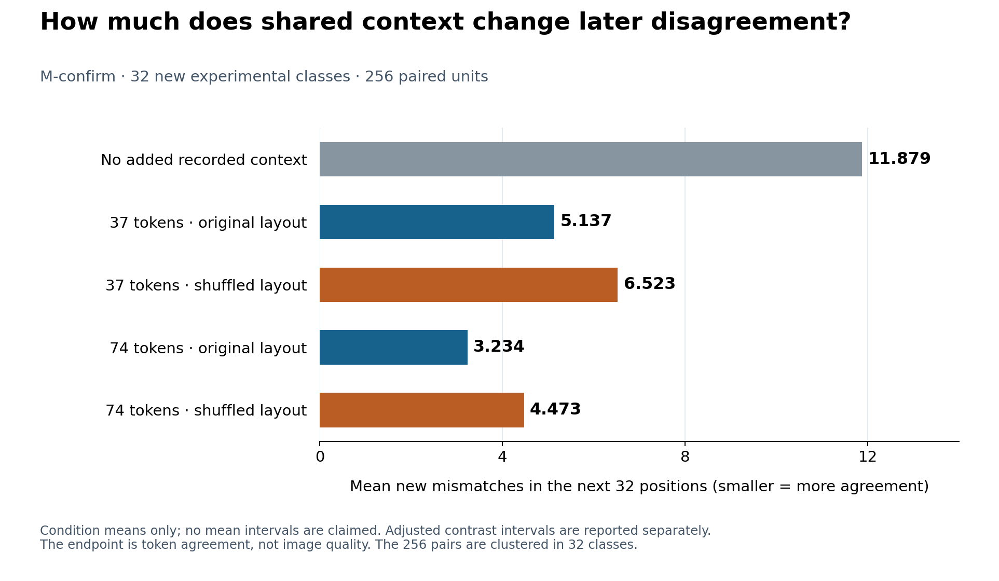
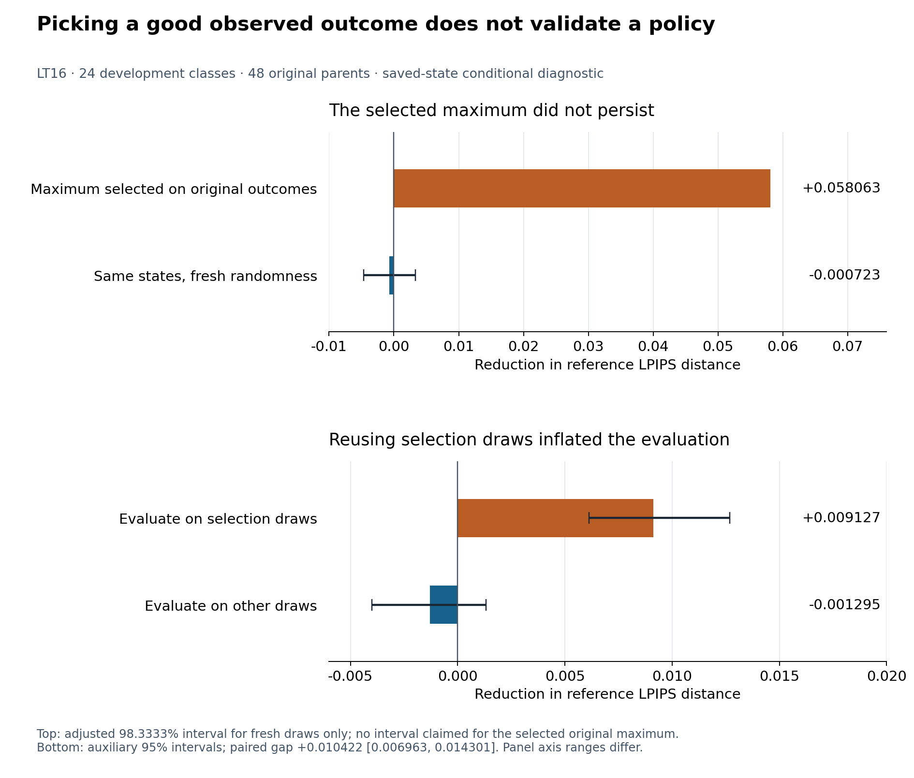

# FDCA · When a small model change alters an image

**Where do two image-generation runs first make different choices, how does that difference spread, and can a limited precision repair reduce it?**

I built controlled comparisons and numerical audit tools to study these questions in masked visual generators. The work separates the occurrence of a changed token, its later consequences, and the signed benefit of a proposed repair. The November follow-up found reproducible context effects in its tested settings; the tested reference-free repair policies did not establish reliable gains over the specified baselines.

**Munsik Kim** · **[한국어 안내](README_KO.md)** · **[Start here in Korean](START_HERE_KO.md)** · [Methods and evidence](research/followup_2026_11/README.md)

## Choose a starting point

| What you want to understand | Read next |
|---|---|
| The question, experiments and conclusions without an ML background | [Illustrated Korean explanation](START_HERE_KO.md) |
| My implementation and the evidence behind it | [Contribution and code map](docs/PORTFOLIO_KO.md) |
| The complete LT0–LT16 research history | [Detailed report](research/followup_2026_11/REPORT_KO.md) |
| Why the repair direction stopped, including positive exceptions | [Failure analysis](research/followup_2026_11/FAILURE_ANALYSIS_KO.md) |
| Exact interventions, comparison units and uncertainty | [Methods](research/followup_2026_11/METHODS_KO.md) · [Validation boundaries](research/followup_2026_11/EVIDENCE_AND_VALIDATION.md) |
| What would justify another experiment | [Unexecuted next-research criteria](research/followup_2026_11/NEXT_RESEARCH_KO.md) |

## The question in ordinary terms

The generator fills a grid of **visual tokens**: learned image-code identifiers, rather than words or individual pixels. Rounding some of its numerical weights can change a token choice. Once that token becomes part of the input for later choices, the two runs may develop differently.

A changed image is not automatically a worse image. Here, **token disagreement** measures different code choices. **LPIPS distance to a reference run** measures a particular image discrepancy. **Human preference** would be a separate evaluation and was not measured. Restoring one calculation's precision also does not erase the different tokens already present in its input.

## Finding A · Shared context changes later disagreement

In M-confirm, the initial different token was held fixed while the two states received the same surrounding tokens. The experiment compared no added recorded context, 37 or 74 visible context tokens, and original or shuffled layouts.

The next 32 positions contained **11.879 new mismatches without the added context versus 3.234 with 74 tokens in their original positions**. The paired reduction was **8.645 tokens**, adjusted 98.3333% CI **[7.137, 10.199]**. This uses 32 new experimental classes and 256 paired units clustered within those classes. “New” concerns this experiment history, not exclusion from model pretraining.

The original layout also reduced disagreement relative to shuffling the same values by **1.238 tokens [0.672, 1.891]**. The interval supports a positive difference but does not clear the prespecified one-token lower-bound criterion. These are effects on subsequent token agreement in the specified experiment, not image-quality gains. [Original contrasts](research/followup_2026_11/evidence/tables/m_confirm_contrasts.csv) · [Unit-level counts](research/followup_2026_11/evidence/tables/m_confirm_units.csv).

## Finding B · A promising observed maximum did not persist

A restoration policy chooses where to spend a limited amount of higher-precision calculation. LT14's retrospective best observed time looked promising. LT16 revisited those selected stored states with fresh random draws.

The selected original value was **+0.058063 LPIPS reduction**. Fresh draws at those states gave **−0.000723**, adjusted 98.3333% CI **[−0.004644, +0.003300]**. A separate split-half analysis also found an optimistic gap when the same draws were used for both selection and evaluation.

These are conditional diagnostics on **24 reused development classes**, not new-class policy performance. The evidence argues against treating the observed maximum as a validated opportunity for a learned policy. It does not prove that all restoration is impossible. [LT16 primary results](research/followup_2026_11/evidence/lt16/expected/primary_contrasts.csv) · [Detailed failure analysis](research/followup_2026_11/FAILURE_ANALYSIS_KO.md).

## Finding C · Positive exceptions remain part of the record

| Experiment | What was tested | Result and boundary |
|---|---|---|
| LT5 | A propagation-based restoration policy on 32 new classes | Its absolute gain and advantage over the local-distribution baseline were unresolved. |
| R-test / LT10 | Frozen policies on 320 new classes; subsequent comparisons reuse those endpoints | All six primary R-test intervals and all 13 adjusted LT10 intervals included zero. This does not establish that every effect is exactly zero. |
| LT12 | One block restored at a time identified using the FP32 reference | Block 2: **+0.017311 [0.000361, 0.035429]**, adjusted 98.75% CI. The result uses reference-derived timing and 64 reused classes. |
| LT12 | Directly replace a divergent token with the reference token | **+0.080290 [0.058796, 0.103802]**, adjusted 98.75% CI. Knowing the replacement token is extra information unavailable to the tested reference-free policy. |
| LT14 / LT15 | Check the development gate before opening reserved evaluation classes | The gate failed; LT15 and its 265 reserved classes remain unexecuted. |

The defensible conclusion is a **controlled account of propagation and a documented failure of the tested policy direction**. The next-research plan requires new evidence before expanding that direction. [Full chronology](research/followup_2026_11/REPORT_KO.md) · [Original LT12 table](research/followup_2026_11/evidence/tables/lt12_primary.csv).

## What I implemented and what is available

| Work | Public implementation or record |
|---|---|
| Enumerate first-divergence events and consequences in controlled synthetic models | [First-divergence code](fdca/core/first_divergence.py) · [Conditional consequences](fdca/core/consequence.py) · [Tests](tests/model_free/) |
| Specify paired sampling and event-addressed randomness for visual experiments | [Conditional coupling](fdca/couplings/p2n_conditional_maximal.py) · [RNG](fdca/rng/p2p_event_addressed.py) · [Adapter contract](fdca/adapters/halton_maskgit_contract.py) |
| Trace follow-up goals, changes, failures and sample reuse | [Experiment ledger](research/followup_2026_11/data/experiment_ledger.csv) · [Methods](research/followup_2026_11/METHODS_KO.md) |
| Replay published numerical evidence and independently audit LT16 scalars | [Replay wrapper](research/followup_2026_11/scripts/replay_public_evidence.py) · [Independent scalar implementation](research/followup_2026_11/evidence/lt16/independent_statistics_lt16.py) |
| Build source-linked figures from stored numbers | [Original figure builder](research/followup_2026_11/scripts/build_figures.py) · [Bilingual explanation figures](research/followup_2026_11/scripts/build_explainer_figures.py) |

The pretrained generator, image decoder, LPIPS metric and numerical libraries are upstream components. The public follow-up package contains selected numerical inputs and analysis scripts, not every historical GPU runner or full raw probability trace. In the follow-up W8 setup, rounded weights were reconstructed into FP32 for calculation; these experiments do not measure packed-INT8 speed or memory savings.

## Recalculate the published evidence on CPU

From the repository root, use Python 3.11 or 3.12 with the declared environment:

~~~bash
python -m venv .venv
. .venv/bin/activate
pip install -r environment/requirements-model-free.txt
make verify test reproduce
python -B research/followup_2026_11/scripts/replay_public_evidence.py --output build/followup-replay
~~~

Read **build/followup-replay/PUBLIC_REPLAY.json**. The publication replay checks 68 source hashes, M-confirm contrasts, R-test/LT10 intervals, 16 byte-identical LT16 CSVs and 4,653 independently recomputed scalar values. It needs no model weights or GPU. Replaying saved measurements does not rerun the generator, decoder or LPIPS network. [Exact boundaries and missing evidence](research/followup_2026_11/EVIDENCE_AND_VALIDATION.md).

For optional figure regeneration, install Matplotlib and a Noto Sans CJK system font for Korean:

~~~bash
pip install matplotlib==3.10.8
python -B research/followup_2026_11/scripts/build_explainer_figures.py --output build/explainer
~~~

The [plotted values](research/followup_2026_11/figures/explainer/plotted_values.csv) and [source hashes](research/followup_2026_11/figures/explainer/sources.json) document all three new figures in both languages. These are descriptive views of existing data, not new experiments or statistical tests.

## Original paper and version history

**Technical preprint; not peer reviewed.** [v1.0.0 PDF](paper/FDCA_v1.0.0.pdf) · [Zenodo record](https://zenodo.org/records/21965747) · [Scientific correction PR #2](https://github.com/Munsik-Kim/fdca-visual-token/pull/2).

The original paper studies two H-MaskGIT checkpoints. The November follow-up is centered on H-MaskGIT-T and has a different design. The archived PDF and DOI remain unchanged. PR #2 is a separate, unmerged correction candidate as of 13 November 2026. The follow-up uses the corrected distinction between equal-block and split-weighted consequences and R = mean(h × m); the product of the two means omits their covariance.

[Historical results at a glance](docs/RESULTS_AT_A_GLANCE.md) · [Full GPU asset requirements](docs/EXTERNAL_ASSET_REGISTRY.md) · [Research publication PR #3](https://github.com/Munsik-Kim/fdca-visual-token/pull/3).

## Citation and licenses

~~~bibtex
@article{kim2026fdca, title={First-Divergence Consequence Analysis: From Quantization Onset to Perceptual Impact in Masked Visual Generators}, author={Kim, Munsik}, year={2026}, doi={10.5281/zenodo.21965747}}
~~~

Original code: MIT. Paper, reports, figures, tables and public audits: CC BY 4.0. Upstream rights remain separate. [License scope](LICENSE_SCOPE.md) · [Third-party notices](THIRD_PARTY_NOTICES.md) · [ORCID](https://orcid.org/0009-0008-9350-2435).
