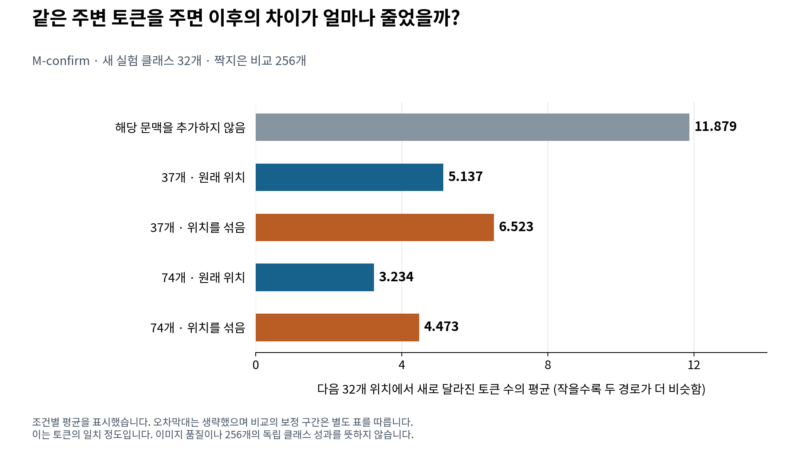
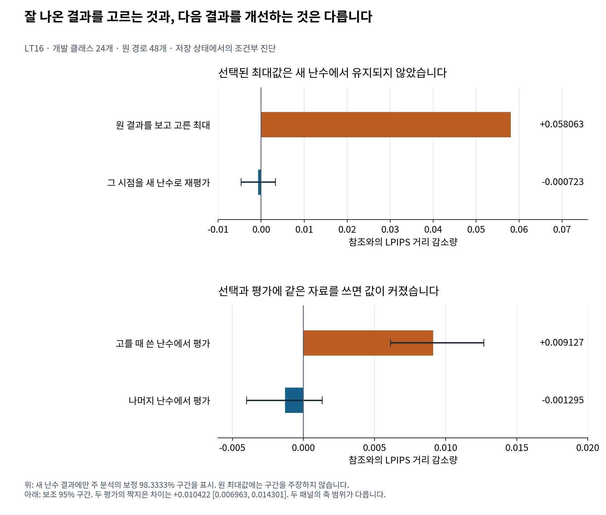

# FDCA · AI 이미지 생성에서 작은 수치 변화는 어디까지 번질까?

**처음 달라지는 선택을 찾고, 그 차이가 퍼지는 과정을 측정한 뒤, 일부 계산을 더 정확하게 하면 되돌릴 수 있는지 시험한 연구입니다.**

저는 이 질문을 확인하기 위해 비교 실험, 분석 코드, 저장 결과를 다시 계산하는 검증 도구를 만들었습니다. 11월 후속 실험에서는 **두 실행이 공유하는 주변 정보가 이후의 차이를 줄이는 현상**을 확인했습니다. 한편 그 관찰을 이용해 정밀도 복원 시점을 고르는 정책은 정해 둔 비교군보다 안정적으로 유리하다는 근거를 확보하지 못했습니다.

**Munsik Kim** · [English](README.md) · **[처음 읽는 분을 위한 자세한 설명](START_HERE_KO.md)** · [구현·기여와 코드](docs/PORTFOLIO_KO.md)

## 어떤 순서로 읽으면 좋을까요?

| 궁금한 점 | 읽을 문서 |
|---|---|
| AI를 전공하지 않았는데 무엇을 연구했는지 알고 싶다 | [쉬운 설명과 한국어 그림](START_HERE_KO.md) |
| 직접 만든 부분과 사용할 수 있는 코드를 보고 싶다 | [포트폴리오·구현 지도](docs/PORTFOLIO_KO.md) |
| LT0부터 LT16까지 왜 실험을 바꿔 왔는지 알고 싶다 | [추가 연구 종합 보고서](research/followup_2026_11/REPORT_KO.md) |
| 복원 정책이 왜 막혔고 어디까지 원인을 밝혔는지 알고 싶다 | [실패 분석](research/followup_2026_11/FAILURE_ANALYSIS_KO.md) |
| 표본·비교군·수식·신뢰구간을 검토하고 싶다 | [정확한 방법](research/followup_2026_11/METHODS_KO.md) · [근거와 검증 범위](research/followup_2026_11/EVIDENCE_AND_VALIDATION.md) |
| 다음 연구에서 반복하지 말아야 할 실수와 재개 조건이 궁금하다 | [후속 연구 기준](research/followup_2026_11/NEXT_RESEARCH_KO.md) |

## 무엇을 비교했나요?

실험 모델은 이미지의 중간 표현을 작은 격자에 채웁니다. 격자의 값인 **시각 토큰**은 학습된 이미지 표현의 번호입니다. 단어도, 개별 픽셀도 아닙니다. 가중치의 숫자를 적은 비트로 반올림하면 어떤 위치에서 고르는 토큰이 달라질 수 있습니다. 그 결과가 다음 선택의 입력에 들어가면서 두 생성 과정이 달라집니다.

여기서는 세 가지 질문을 구분합니다.

| 질문 | 측정한 것 | 해석 |
|---|---|---|
| 두 실행이 얼마나 다르게 전개되는가? | 이후 위치에서 토큰 값이 다른 개수 | 두 경로의 일치 정도 |
| 복원 후 원래 정밀도의 참조 결과에 가까워지는가? | 참조 이미지와의 LPIPS 거리 감소량 | 지정한 참조와의 거리 변화 |
| 사람이 보기에 더 좋은 이미지인가? | 별도의 사람 평가가 필요 | 이번 후속 실험에서는 측정하지 않음 |

참조 이미지도 AI가 생성한 한 결과입니다. 자동으로 “정답 이미지”가 되는 것은 아닙니다. 또한 이 실험의 W8은 반올림한 가중치를 FP32로 재구성해 계산한 조건입니다. 실제 8비트 실행 커널의 속도·메모리 이득을 측정한 결과로 소개하지 않습니다.

## 확인한 결과 1 · 공통 문맥은 이후의 차이를 줄였습니다

이미 처음 달라진 토큰은 그대로 두고, 그 주변의 **같은 토큰들을 두 상태에 똑같이 제공**했습니다. 문맥의 개수와 배치도 바꿔 비교했습니다.

M-confirm의 새 실험 클래스 32개·짝지은 비교 256개에서, 이후 32개 위치의 새 불일치는 문맥을 추가하지 않았을 때 **평균 11.879개**, 74개 문맥을 원래 위치에 넣었을 때 **3.234개**였습니다. 짝지어 계산한 감소량은 **8.645개**, 보정 98.3333% 신뢰구간은 **[7.137, 10.199]개**입니다.

같은 74개 값이라도 원래 배치가 섞은 배치보다 **1.238개 [0.672, 1.891]** 더 줄였습니다. 방향은 확인됐지만, 구간 하한이 사전에 정한 “최소 한 토큰” 기준을 넘지는 않았습니다. 그래프의 막대는 조건별 평균이며, 비교의 불확실성은 이처럼 **차이의 구간**으로 확인합니다.

이 결과가 말하는 것은 지정한 실험에서의 **전파 감소**입니다. 더 좋은 이미지나, 운영 중 자동으로 좋은 문맥을 구하는 알고리즘의 성과는 별도로 평가해야 합니다. [원 비교표](research/followup_2026_11/evidence/tables/m_confirm_contrasts.csv).

## 확인한 결과 2 · 가장 잘 나온 시점의 이득은 새 난수에서 유지되지 않았습니다

정밀도 복원은 가중치의 일부 계산을 잠시 원래 FP32 값으로 돌리는 개입입니다. LT14에서는 여러 시점의 결과를 보고 가장 큰 이득을 고르면 평균 **+0.058063**이 나왔습니다. LT16은 그 시점의 저장 상태를 고정하고 새 난수로 반복했습니다.

새 평균은 **−0.000723**, 보정 98.3333% 구간은 **[−0.004644, +0.003300]**이었습니다. 같은 난수에서 시점을 고르고 평가할 때의 값이 다른 난수에서 평가한 값보다 커지는 현상도 확인했습니다. **한 번 잘 나온 결과를 골랐다는 사실만으로 다음에도 좋은 결정을 내릴 수 있다고 판단하기 어려웠습니다.**

이 결과는 개발 클래스 24개·원 경로 48개에서 고른 저장 상태에 관한 진단입니다. 새 클래스의 성능 평가가 아닙니다. 구간이 0을 포함하므로 정확한 무효나 악화를 확정하지 않습니다. [자세한 실패 분석](research/followup_2026_11/FAILURE_ANALYSIS_KO.md).

## 양의 결과와 실패를 함께 기록했습니다

| 실험 | 관측 결과 | 현재 판단 |
|---|---|---|
| LT3·LT4 | 초기의 일회 변화가 후기보다 큰 영향을 보임 | 영향의 크기에 관한 결과. 복원 이득으로 바로 해석하지 않음 |
| M-confirm·LT11 | 문맥의 양·배치·출처를 바꾸면 후속 토큰 차이가 줄어듦 | 해당 모델·개입·짝짓기 조건에서 지지 |
| LT5·R-test | 복원 정책의 주요 신뢰구간이 0을 포함 | 지정한 기준 정책 대비 안정적 이득 미확인 |
| LT12 | 참조에서 시점을 알아낸 block 2 복원: **+0.017311 [0.000361, 0.035429]** | 양의 결과 보존. 보정 98.75% 구간, 재사용 64클래스의 진단이며 실행 시 참조 정보가 필요 |
| LT14·LT15 | 개발 기준 실패 뒤 예약 265클래스를 열지 않음 | 확인 실험 미실행 |
| LT16 | 선택된 최대 이득이 새 난수에서 유지되지 않음 | 선택 편향을 줄이는 평가 설계가 필요 |

따라서 연구의 현재 성과는 **전파 현상을 설명하는 통제 실험과, 복원 정책이 막힌 이유를 검증 가능한 기록으로 남긴 것**입니다. 현재 정책의 반복 확대는 보류했습니다. 새 행동이나 참조 없이 유용한 시점을 찾는 근거가 생기면 정해진 기준에 따라 재개할 수 있습니다.

## 실제 구현과 재현

최초 분기와 조건부 결과 계산, 실험용 결합 추출과 난수 관리, 클래스 단위 통계, 수치 재생과 그림 생성을 공개했습니다. 사용한 사전학습 모델·이미지 디코더·LPIPS는 기존 구성요소입니다. [구현과 재사용 구분](docs/PORTFOLIO_KO.md).

Python 3.11 또는 3.12에서 저장소 루트 기준으로 실행합니다.

~~~bash
python -m venv .venv
. .venv/bin/activate
pip install -r environment/requirements-model-free.txt
make verify test reproduce
python -B research/followup_2026_11/scripts/replay_public_evidence.py --output build/followup-replay
~~~

GPU나 모델 가중치 없이 저장된 측정값을 다시 계산합니다. 검증 범위는 공개 근거 파일 68개의 해시, M-confirm·R-test·LT10의 주요 대비, LT16 표 16개와 독립 계산값 4,653개입니다. **모델을 새로 실행해 이미지를 다시 만든 검증과는 범위가 다릅니다.** 일부 초기 원자료가 확보되지 않은 부분도 [근거 문서](research/followup_2026_11/EVIDENCE_AND_VALIDATION.md)에 명시했습니다.

## 논문·공개판·권리

[기존 v1.0.0 논문](paper/FDCA_v1.0.0.pdf) · [Zenodo / DOI 10.5281/zenodo.21965747](https://zenodo.org/records/21965747) · [과학적 정정 PR #2](https://github.com/Munsik-Kim/fdca-visual-token/pull/2) · [후속 연구 공개 PR #3](https://github.com/Munsik-Kim/fdca-visual-token/pull/3).

논문은 동료평가 전 기술 프리프린트입니다. 기존 논문은 두 H-MaskGIT 체크포인트를 다루며, 11월 후속 실험은 주로 Tiny 모델을 다룹니다. 두 범위의 표본과 수치를 합치지 않습니다. 원 논문·DOI는 보존했고, 정정 PR #2는 2026-11-13 현재 별도 미병합 수정안입니다.

독립 작성 코드는 MIT, 논문·보고서·그림·표는 CC BY 4.0입니다. 외부 모델과 자료의 권리는 별도로 적용됩니다. [라이선스 범위](LICENSE_SCOPE.md) · [외부 구성요소](THIRD_PARTY_NOTICES.md).
