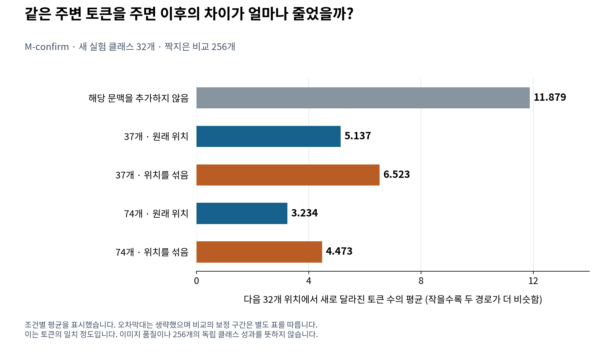
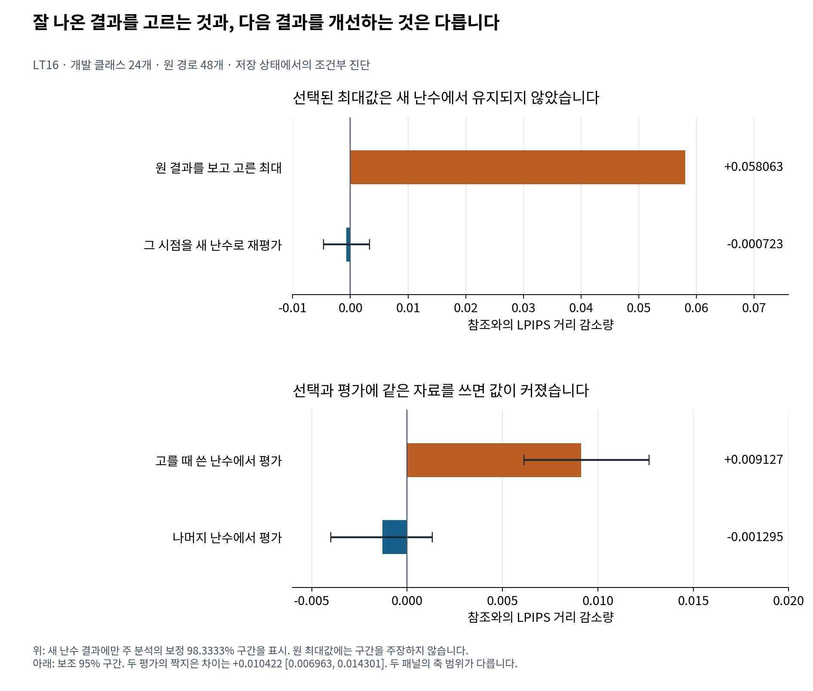
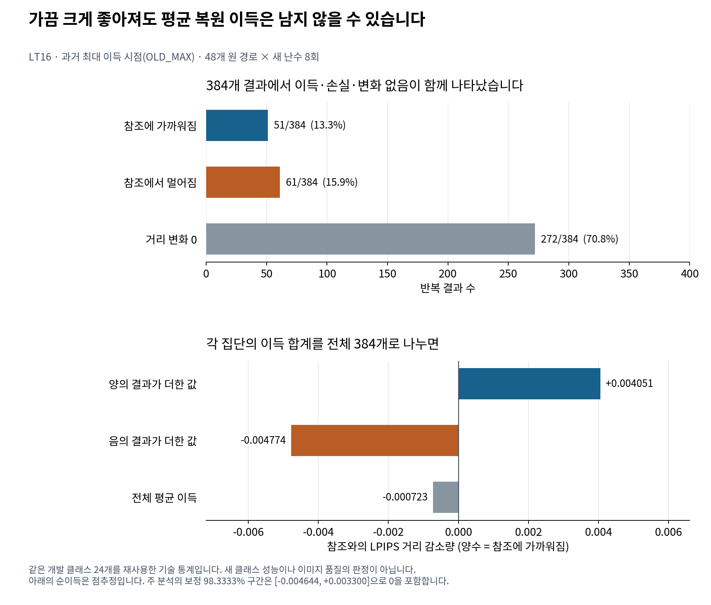

# 숫자를 더 정확하게 계산하면 AI의 선택도 돌아올까?

**FDCA 후속 연구를 처음 읽는 분을 위한 설명**

Munsik Kim · 2026-11-13 · [저장소 소개](README_KO.md) · [전체 연구 보고서](research/followup_2026_11/REPORT_KO.md) · [구현과 기여](docs/PORTFOLIO_KO.md)

## 1. 먼저 알아야 할 연구 결과

이 연구는 이미지 생성 AI의 계산에 작은 근사를 넣었을 때, 처음 어떤 선택이 달라지고 그 차이가 이후에 어떻게 퍼지는지 추적합니다. 이어서 “영향이 큰 지점만 더 정확하게 계산하면 원래 결과에 가까워질까?”를 시험했습니다.

답은 질문별로 달랐습니다. 같은 주변 정보를 두 생성 상태에 주면 이후 토큰의 차이가 줄었습니다. 반면 그 관찰을 이용해 복원 시점을 선택하는 방법은 정해 둔 기준을 만족하지 못했습니다. 특히 한 번의 실행에서 가장 좋아 보였던 복원 시점이, 새 난수로 다시 시험했을 때도 좋은 시점이라는 근거는 남지 않았습니다.

| 현재 판단 | 실제 의미 |
|---|---|
| 공통 문맥의 전파 효과를 확인 | 같은 최초 차이를 고정한 실험에서, 공유하는 주변 정보의 양·배치·출처가 이후 차이에 영향을 줌 |
| 시험한 복원 정책의 성공 미확인 | 참조 정보 없이 시점을 고르는 정책이 지정한 비교군보다 안정적으로 유리하다는 근거를 확보하지 못함 |
| 조건부로 도움이 되는 복원은 존재 | 참조에서 최초 불일치 시점을 알아낸 LT12의 block 2 복원은 양의 결과 |
| 선택된 최대값의 낙관성 확인 | 결과를 보고 가장 좋은 시점을 고르면 값이 커 보였고, 다른 난수로 평가하면 그 이득이 유지되지 않음 |
| 현재 방식의 확대 보류 | 개발 기준이 실패했기 때문에 예약된 확인 표본을 사용하지 않음 |

여기서 “실패”는 연구 전체가 무의미하다는 판정이 아닙니다. **어떤 질문에는 근거가 생겼고, 어떤 알고리즘 목표는 달성하지 못했는지 구체적으로 구분한 상태**입니다.

## 2. AI가 이미지를 만든다는 것을 어떻게 실험했나요?

11월 후속 실험의 중심 모델은 기존에 공개된 **H-MaskGIT-T**입니다. 이 생성기는 이미지의 중간 표현을 16×16 격자, 총 256개 위치에 채웁니다. 각 위치의 값은 학습된 이미지 코드북의 번호입니다. 이 번호를 **시각 토큰**이라고 부릅니다. 완성된 토큰 격자는 이미지 디코더를 통해 사람이 볼 수 있는 이미지가 됩니다.

따라서 여기서 토큰 하나가 다르다는 것은 “그 위치의 코드 번호가 다르다”는 뜻입니다. 단어 하나가 틀렸거나 픽셀 하나의 색이 달라졌다는 뜻은 아닙니다. 코드 번호의 차이가 실제 이미지에 얼마나 나타나는지는 별도로 계산합니다.

모델은 현재 채워진 토큰들과 이미지 종류 조건을 보고 다음 값들의 확률을 계산합니다. 그 확률에 따라 토큰을 추출하고, 새 상태를 다음 계산의 입력으로 사용합니다. 실험은 정해진 좌표 순서와 32단계 생성 스케줄을 사용합니다. 한 단계가 반드시 한 토큰에 해당하는 것은 아닙니다.

**가중치**는 이런 계산에 사용하는 모델 내부 숫자입니다. **양자화**는 이 숫자를 제한된 정밀도의 값으로 바꾸는 것입니다. 본 후속 실험의 W8 조건에서는 대상 49개 행렬을 8비트 수준으로 반올림한 뒤 FP32 숫자로 재구성해 계산했습니다. 숫자 근사의 영향을 분리하려는 설정입니다. 가중치를 실제로 8비트 커널에서 연산한 속도·메모리 벤치마크와는 구분합니다.

**FP32 복원**은 지정한 블록의 8개 가중치 행렬을 원래 FP32 값으로 되돌려 계산한다는 뜻입니다. 블록은 모델의 연속된 처리 구간입니다. block 2는 0부터 세어 세 번째 구간입니다. 그 순간에도 다른 대상 행렬은 W8이고, 이전에 선택된 토큰은 그대로입니다.

[정확한 모델 설정·행렬 목록](research/followup_2026_11/METHODS_KO.md)

## 3. “달라짐”, “참조에 가까워짐”, “좋아짐”은 무엇이 다른가요?

연구에서 가장 쉽게 혼동되는 부분입니다.

| 표현 | 이번 연구에서의 정의 | 바로 결론낼 수 없는 것 |
|---|---|---|
| 최초 불일치 | 짝지어 비교하는 두 실행이 처음 다른 토큰 값을 선택 | 사람이 판단한 오류의 시작 |
| 전파 | 처음 생긴 차이 뒤에서 두 실행의 토큰이 얼마나 달라지는가 | 그 차이가 모두 나쁜 변화라는 판단 |
| 이미지 거리 | 두 출력 이미지의 LPIPS 값 | 사람의 선호도·의미 정확도·업무 품질 |
| 복원 이득 G | 개입 전 참조 거리에서 개입 후 참조 거리를 뺀 값 | 더 아름답거나 유용한 이미지가 됐다는 판단 |
| 기술 검증 통과 | 지정한 코드·파일·집계 검사가 맞음 | 연구 가설 성공·새 모델에서의 일반성 |

**LPIPS**는 기존 신경망의 이미지 특징을 이용해 두 이미지의 차이를 수치화하는 지표입니다. 여기서는 원래 정밀도로 생성한 **참조 이미지**와의 거리를 측정합니다. 그 참조도 확률적으로 생성된 하나의 결과이며 사람이 지정한 정답은 아닙니다.

복원 이득의 식을 말로 쓰면 다음과 같습니다.

> G = 복원하지 않았을 때의 참조 거리 − 복원했을 때의 참조 거리

G가 양수면 참조에 가까워지고, 음수면 참조에서 멀어집니다. 0이면 그 거리 측정값에 변화가 없습니다. 거리 0 변화만으로 모든 내부 계산까지 같다고 단정하지 않습니다.

## 4. 어떻게 비교를 공정하게 만들었나요?

AI 생성에는 난수가 들어갑니다. 두 실행을 아무렇게나 돌려 다른 그림이 나왔다면, 가중치 변경 때문인지 임의의 선택 차이 때문인지 구분하기 어렵습니다. 이 연구는 두 실행의 확률적 선택을 함께 구성하는 **결합(coupling)**을 실험의 일부로 정의했습니다. 단순히 같은 seed 숫자를 넣었다는 설명만으로 모든 비교가 같아지는 것은 아닙니다.

또한 질문에 따라 서로 다른 비교를 썼습니다.

| 실험 종류 | 맞춰 둔 부분 | 바꾼 부분 | 답하는 질문 |
|---|---|---|---|
| 원 논문의 단일 변화 실험 | 시작 상태와 이후 공통 W8 실행 조건 | 한 seed 전이에서 FP32와 W8의 계산 | 첫 차이가 발생할 가능성과 이후 영향은 얼마인가? |
| 문맥 실험 | 최초 다른 위치와 두 토큰 값, 이후 평가 좌표·결합 | 양쪽에 함께 주는 주변 토큰 | 같은 처음 차이의 전파가 문맥에 따라 바뀌는가? |
| 복원 정책 실험 | 참조·기준 생성 조건, 지정된 비교 예산 | 복원 블록과 시점 | 개입이 참조 거리를 실제로 줄이는가? |
| LT16 재평가 | 기존에 선택한 저장 상태와 시점 | 그 이후의 새 난수 | 처음 좋아 보인 개입이 반복 평균에서도 좋은가? |

아래는 **문맥 실험의 비교 구조**입니다. 새 실험 이미지나 실제 토큰 배열을 그린 것은 아닙니다.

~~~mermaid
flowchart TD
    S["같은 부모 상태와 최초 불일치를 고정"] --> A["상태 A: 한 위치에 토큰 a"]
    S --> B["상태 B: 같은 위치에 토큰 b"]
    C["같은 주변 토큰을 두 상태에 제공"] --> A
    C --> B
    A --> X["정해진 방식으로 다음 32개 위치를 함께 추출"]
    B --> X
    X --> Y["새로 다른 토큰의 개수를 비교"]
~~~

두 실행이 공통으로 받는 주변 정보만 바꿉니다. 처음 다른 a와 b를 같은 값으로 고쳐 주는 실험은 아닙니다. 또 두 경로가 공통된 잘못된 결과로 가까워져도 불일치 개수는 줄 수 있으므로, 전파 감소와 품질 개선을 같은 목표로 취급하지 않습니다.

## 5. 공통 문맥 실험에서 실제로 무엇이 나왔나요?

**공통 문맥**은 두 상태에 똑같이 넣은 주변 토큰입니다. M-confirm은 기록된 74개 토큰을 원래 위치에 넣는 조건, 그 값들을 같은 위치 집합 안에서 섞는 조건, 문맥을 37개로 줄인 조건을 비교했습니다. H/L은 높은/낮은 문맥 가시 범위를 뜻하며 계산 정밀도가 아닙니다.

| 조건 | 다음 32개 위치의 새 불일치 평균 | 이 비교가 필요한 이유 |
|---|---:|---|
| 해당 문맥 추가 없음 | 11.878906 | 출발 기준 |
| 37개, 원래 배치 | 5.136719 | 적은 문맥을 원래 위치에 제공 |
| 37개, 섞은 배치 | 6.523438 | 적은 문맥에서 값 집합과 위치의 관계를 점검 |
| 74개, 원래 배치 | 3.234375 | 많은 문맥을 원래 위치에 제공 |
| 74개, 섞은 배치 | 4.472656 | 같은 값 집합을 제공하되 위치 배치를 바꿈 |

이 표는 **조건별 평균**입니다. 원자료에서 클래스 안의 비교를 먼저 평균한 다음 32개 클래스를 동일하게 평균했습니다. 각 클래스에 비교가 8개씩 있어 이 자료에서는 전체 256개 평균과 수치가 같습니다. 막대별 신뢰구간을 새로 만들어 주장하지 않았습니다.

주 질문 세 개는 차이를 직접 계산해 평가했습니다.

| 주 질문 | 감소량 | 보정 98.3333% 구간 | 판정 |
|---|---:|---|---|
| 문맥 없음보다 74개 원래 배치가 유리한가? | 8.644531개 | [7.136719, 10.199219] | 양의 방향 및 한 토큰 하한 기준 통과 |
| 같은 74개에서 원래 배치가 섞은 배치보다 유리한가? | 1.238281개 | [0.671875, 1.890625] | 양의 방향 확인, 한 토큰 하한 기준 미통과 |
| 문맥 37개보다 74개가 유리한가? | 1.976563개 | [1.570313, 2.417969] | 두 배치에 걸친 평균 효과, 한 토큰 하한 기준 통과 |

마지막 행은 **원래 배치에서의 증가 효과와 섞은 배치에서의 증가 효과를 평균**한 것입니다. 원래 배치 한 조건만의 효과 1.902344개를 대신 넣으면 다른 비교가 됩니다.

M-confirm은 개발 이후 새로 사용한 실험 클래스 32개에서 수행했습니다. 여기서 새 클래스는 앞의 개발 단계에 쓰지 않았다는 뜻입니다. 사전학습 때 모델이 보지 않았다는 의미는 아닙니다. 원 자료의 “256짝”도 독립된 클래스 256개라는 뜻은 아닙니다.

LT11에서는 다른 클래스에서 가져온 문맥도 두 경로에 공통으로 넣으면 효과가 있는지 따로 조사했습니다. 새 64클래스를 32쌍으로 묶었을 때, 다른 출처의 문맥도 평균 **6.972656개 [5.957031, 8.101563]**의 차이를 줄였습니다. 자기 출처 문맥은 그보다 **1.720703개 [1.349609, 2.121094]** 더 줄였습니다. 이 구간은 별도 실험의 보정 97.5% 구간입니다.

따라서 공통으로 주어지는 정보 자체와 출처 일치 모두 관련됐습니다. 출처를 바꾸면 값·배치·수신 상태와의 적합성이 함께 달라지므로 이를 순수한 “의미 이해” 효과라고 단정하지 않습니다. M-confirm과 LT11의 표본 수나 효과를 합쳐 하나의 결과로 만들지도 않습니다.

[원 M-confirm 표](research/followup_2026_11/evidence/tables/m_confirm_contrasts.csv) · [원 LT11 표](research/followup_2026_11/evidence/tables/lt11_contrasts.csv)

## 6. 그렇다면 중요한 시점을 더 정확히 계산하면 되지 않나요?

그것이 복원 실험의 목표였습니다. 다만 “변경하면 결과가 크게 달라지는 곳”을 찾는 것과 “변경하면 원하는 방향으로 좋아지는 곳”을 찾는 것은 서로 다른 과제입니다.

초기 LT3·LT4에서는 이른 시점의 일회 변화가 뒤 시점보다 큰 결과 차이를 만들었습니다. 그래서 제한된 복원 예산을 이른 시점이나 민감한 블록에 쓰는 정책을 시험했습니다. 정책은 복원 위치를 고르는 규칙입니다. **어느 정책이 같은 조건의 단순한 규칙보다 실제 이득을 주는지**가 판단 기준입니다.

| 단계 | 목적 | 결과 |
|---|---|---|
| LT1-R | 한 블록을 전체 생성 과정에서 복원 | 작은 개발 표본에서 절대 이득 미확정; 여러 선택 점수가 같은 블록을 선택 |
| LT5 | 8 block-step 예산을 배분 | 새 32클래스에서 절대 이득과 비교군 대비 추가 이득 모두 미확정 |
| R-test | 개발에서 고정한 정책을 더 큰 새 표본에 평가 | 새 320클래스·640단위에서 여섯 주 구간 모두 0 포함 |
| LT10 | R-test의 결과로 블록·시점 대비를 더 살펴봄 | 13개 다중 비교 보정 구간 모두 0 포함; 새 표본 실험은 아님 |
| LT12 | 참조에서 좋은 위치·값을 알아낸 진단 | 참조 토큰 편집과 block 2의 시점 복원에서 양의 결과 |
| LT14 | 참조 없이 현재 상태의 특징으로 시점을 선택 | 단순 비교군 대비 사전 개발 기준 미달 |
| LT16 | 선택한 시점의 평균 이득을 새 난수로 점검 | 원 최대값 유지 실패와 선택 낙관성 확인 |

**신뢰구간이 0을 포함한다는 것은 양의 효과나 음의 효과의 방향을 충분히 정하지 못했다는 뜻**입니다. 모든 가능한 정책이 무효라는 뜻은 아닙니다. 일부 구간은 여전히 유용한 크기의 이득도 허용하고, 일부 지정 대비는 미리 정한 작은 효과 범위 안에 들어갑니다. 자세한 수치와 이 차이는 [종합 보고서](research/followup_2026_11/REPORT_KO.md)에 남겼습니다.

## 7. LT12의 양의 결과는 왜 중요한가요?

부정적 결론에 맞추려고 이 결과를 빼면 연구를 잘못 설명하게 됩니다.

LT12는 FP32 참조 경로를 함께 보고 **처음 불일치하는 시점**을 알아냈습니다. 이렇게 정답에 해당하는 추가 정보를 가진 진단 조건을 연구에서는 **oracle 조건**이라고 부릅니다. 초능력이 있는 모델을 만들었다는 뜻이 아니라, 실행 중 실제 정책에는 없는 정보를 일부러 제공해 가능성을 조사한다는 뜻입니다.

| LT12 개입 | 평균 참조 거리 감소 G | 보정 98.75% 구간 |
|---|---:|---|
| 최초 다른 토큰을 참조 토큰으로 직접 바꿈 | +0.080290 | [+0.058796, +0.103802] |
| 참조에서 알아낸 시점에 block 2를 한 번 복원 | +0.017311 | [+0.000361, +0.035429] |
| 같은 종류의 시점에 block 3을 한 번 복원 | +0.008156 | [−0.005976, +0.022815] |

block 2는 양의 방향이 확인됐지만, 구간 하한이 실용 기준 +0.01을 넘지는 않았습니다. 이 실험은 R-test에서 사용한 64클래스를 재사용했습니다. 참조 토큰과 시점을 알아내는 비용·방법을 갖춘 실제 정책의 독립 평가로 소개할 수는 없습니다.

그래도 이 결과는 “더 정확히 계산하는 개입은 어떤 조건에서도 도움이 안 된다”는 설명을 배제하는 중요한 예외입니다. 해결되지 않은 문제는 **참조 없이 도움이 되는 상태와 행동을 어떻게 찾아내느냐**입니다. LT12와 LT16은 선택 방법과 표본·난수 조건이 달라, 같은 실험의 단순 재현 실패로 대응시키지 않습니다.

[LT12 네 가지 주 비교 전체](research/followup_2026_11/evidence/tables/lt12_primary.csv)

## 8. 가장 잘 나온 시점을 고르면 왜 과대평가하기 쉬운가요?

어떤 시점의 관측 이득에는 그 상태의 특성과 이번 난수 실현의 영향이 함께 들어갑니다. 여러 시점을 실행하고 결과가 가장 좋았던 것만 고르면, 우연히 유리했던 난수도 함께 선택될 수 있습니다. 다음 실행에서도 쓸 수 있는 규칙을 검증하려면 고를 때 사용한 결과와 별도의 결과로 평가해야 합니다.

LT14의 48개 원 경로에서 결과를 보고 고른 최대값의 평균은 +0.058063이었습니다. LT16은 이 시점을 포함한 선택 규칙들이 지목한 **고유 저장 상태 158개**를 각각 새 난수 8회로 평가했습니다. 전체 고유 실험은 1,264개입니다.

그중 과거 최대값을 고른 OLD_MAX 규칙의 새 평균은 −0.000723이었고, 주 분석의 보정 구간은 [−0.004644, +0.003300]이었습니다. 원 최대값은 결과를 보고 고른 기술 통계이며 같은 수준의 확인 신뢰구간을 붙이지 않았습니다.

별도의 진단에서는 난수 반복을 두 절반으로 나눴습니다. 한 절반에서 시점을 고르고 같은 절반에서 평가한 값은 +0.009127, 다른 절반에서 평가한 값은 −0.001295였습니다. 두 평가의 **짝지은 차이**는 +0.010422, 보조 95% 구간 [0.006963, 0.014301]이었습니다. 이 보조 구간을 주 분석의 보정 구간과 섞어 소개하지 않습니다.

여기서 시점 후보는 부모별 2–5개로, 원 LT14의 모든 32시점을 새로 다 평가한 것은 아닙니다. 재평가도 기존 저장 상태에 조건화되어 있습니다. 따라서 연구가 배제한 것은 “관측 최대값 +0.058을 곧바로 실현 가능한 정책 이득으로 받아들이는 해석”이며, 모든 상태와 행동의 잠재 이득을 조사한 결과는 아닙니다.

## 9. 실제로 어떤 이득과 손실이 상쇄됐나요?

OLD_MAX에 해당하는 48개 원 경로 × 8반복, 총 384개 결과를 나누면 다음과 같습니다.

| 결과 | 개수 | 전체 384개 중 비율 | 그 집단 안의 평균 G | 전체 평균에 더한 값 |
|---|---:|---:|---:|---:|
| 참조에 가까워짐 | 51 | 13.2813% | +0.030500 | +0.004051 |
| 참조에서 멀어짐 | 61 | 15.8854% | −0.030054 | −0.004774 |
| 거리 변화 0 | 272 | 70.8333% | 0 | 0 |
| 합계 | 384 | 100% | 전체 평균 −0.000723 | −0.000723 |

마지막 열은 각 집단의 G를 모두 더한 뒤 **전체 384개**로 나눈 값입니다. 양의 결과 51개만 보여 주면 개입이 유망해 보일 수 있지만, 음의 결과와 변화 없는 결과를 포함하면 평균이 달라집니다.

이 표의 비율은 새로운 사용자나 이미지에서의 성공률이 아닙니다. 같은 개발 클래스 24개에서 재사용한 저장 상태의 반복 결과입니다. 평균이 음수라는 점추정과 “해로운 개입이라고 확정했다”는 판단도 구분해야 합니다. 해당 평균의 주 신뢰구간은 0을 포함합니다.

[384행의 원 출처](research/followup_2026_11/evidence/lt16/expected/selector_draws.csv) · [원 부호별 집계](research/followup_2026_11/evidence/lt16/expected/signed_contributions.csv)

## 10. 표본 수와 신뢰구간은 어떻게 읽어야 하나요?

**클래스**는 이미지 종류를 나타내는 실험용 범주입니다. **부모 경로**는 개입·재평가가 출발하는 원 생성 경로입니다. 같은 부모의 상태를 여러 번 다시 실행했다고 새 클래스가 늘어나는 것은 아닙니다.

| 실험 | 클래스 또는 클래스 쌍 | 더 작은 단위의 수 | 독립성에 관한 주의 |
|---|---:|---:|---|
| M-confirm | 새 32클래스 | 256짝 | 클래스 안의 비교를 먼저 평균 |
| R-test | 새 320클래스 | 640단위 × 기준·8행동 = 5,760 endpoints | 5,760개의 독립 클래스가 아님 |
| LT11 | 새 64클래스, 32쌍 | 512단위 | 미리 묶은 클래스 쌍이 재표집 단위 |
| LT16 | 재사용 24클래스, 48부모 | 158고유 상태 × 8반복 = 1,264 | 저장 상태 조건부 진단; 새 클래스 확인이 아님 |

신뢰구간은 관측된 표본과 분석 가정 아래 효과 추정의 불확실성을 표현합니다. 여기서는 클래스 또는 설계된 클래스 쌍을 다시 뽑는 bootstrap을 사용했습니다. “이번 구간 안에 효과가 들어갈 확률이 정확히 95%다”라는 뜻으로 읽지는 않습니다.

여러 질문을 한꺼번에 검사하면 우연히 좋아 보이는 결과를 만날 기회도 늘어납니다. 그래서 M-confirm·LT16의 주 질문 세 개에는 각각 98.3333%, R-test의 여섯 개에는 99.1667% 등 보정된 구간을 사용했습니다. 단계마다 비교 묶음이 다르며 연구 전체의 모든 시도를 한꺼번에 보정한 보장을 주장하지 않습니다.

**방향 기준**과 **실용 기준**도 다릅니다. 구간 전체가 0보다 크면 양의 방향에 근거가 생깁니다. 하지만 “최소 한 토큰 감소”가 기준이면 구간 하한이 1을 넘어야 합니다. M-confirm의 배치 효과는 전자는 만족했으나 후자는 만족하지 못했습니다.

[추정량·resampling·보정 정의](research/followup_2026_11/METHODS_KO.md)

## 11. 실패 원인은 어디까지 밝혔나요?

| 설명 | 근거 수준 | 다음에 필요한 확인 |
|---|---|---|
| 같은 결과로 시점을 고르고 평가하면 낙관적 값이 생김 | LT16의 재평가와 split-half 진단에서 직접 지지 | 새로운 정책에서도 선택·평가 난수와 클래스를 분리 |
| 현재 상태 특징이 시간 정보보다 유용하지 않았음 | 시험한 선택기 차이와 새 평균 예측오차에서 제한적으로 지지 | 새로운 특징과 반복 평균 이득을 독립 자료에서 확인 |
| 이미 달라진 토큰 상태가 일회 복원을 제한할 수 있음 | 실험 구조에 부합하는 설명 | 상태 정렬과 복원 행동을 분리한 개입 필요 |
| 나머지 W8 블록이 복원 효과를 상쇄할 수 있음 | 가능한 메커니즘 | 동일 비용의 다중 블록 대조 등 추가 실험 필요 |
| 모든 양자화·모델에서 같은 문제가 생김 | 현재 근거로 판단할 수 없음 | 별도 모델·양자화 조건에서 동결한 비교 필요 |

즉 가장 직접적인 실패 진단은 선택 낙관성입니다. 상태·다른 블록·결합이 각각 어느 정도 원인인지까지 분해한 것은 아닙니다. “원인 후보”와 “실험으로 분리한 원인”을 같은 문장으로 쓰지 않았습니다.

## 12. 이 연구에서 구현한 역량과 다음 결정

연구 과정에서는 가설을 실행 가능한 비교로 바꾸고, 무엇을 같게 둘지 정하고, 난수·표본 재사용을 기록하고, 결과와 신뢰구간을 다시 계산할 수 있게 만드는 작업이 필요했습니다. 양의 결과뿐 아니라 개발 기준 실패, 미완료 감사, 원자료가 확보되지 않은 부분도 함께 정리했습니다.

현재 공개 자료로 확인할 수 있는 것은 통제 실험의 기록, 기존 코드, 수치 검산, 기존 데이터를 이용한 그림입니다. 11월의 모든 GPU 실행 스크립트·확률분포 원자료·생성 이미지가 공개된 완전한 재실행 패키지는 아닙니다. 모델을 실행하지 않는 수치 재생과 새 GPU 재현은 구분합니다.

다음 방향은 세 가지 기준으로 좁혀져 있습니다.

1. **전파 메커니즘:** 한 가지 추가 모델 또는 설정에서 문맥 효과의 비교를 먼저 동결하고 확인합니다. 이는 제안이며 실행 결과가 아닙니다.
2. **실제 개입:** 생성 중 실제로 얻을 수 있는 문맥이나 수정 방향을 정의하고, 획득 비용까지 맞춘 기준 정책과 비교해야 합니다.
3. **복원 재개:** 참조 없이 유용한 상태를 구분하는 새 근거 또는 반복 평균에서 유리한 새 행동이 있어야 합니다. 같은 정책의 표본만 늘리는 것을 기본 경로로 삼지 않습니다.

LT15의 예약 265클래스는 여전히 미실행입니다. 다음 실험의 표본·분석·중단 기준을 결과를 보기 전에 정하기 위한 여지를 남겼습니다.

[구현·기여와 코드](docs/PORTFOLIO_KO.md) · [전체 이력](research/followup_2026_11/REPORT_KO.md) · [재개·중단 조건](research/followup_2026_11/NEXT_RESEARCH_KO.md)

## 13. 그림과 숫자를 직접 확인하려면

이번 설명 그림은 모두 기존 공개 표·저장 측정값에서 만들었습니다. 새로운 AI 이미지를 생성하거나 성공 사례를 꾸며 넣지 않았습니다. 한국어와 영어 그림은 같은 수치를 사용합니다.

[그림의 수치·집계·출처](research/followup_2026_11/figures/explainer/plotted_values.csv) · [입력 파일 SHA-256](research/followup_2026_11/figures/explainer/sources.json) · [그림 생성 코드](research/followup_2026_11/scripts/build_explainer_figures.py).

저장소의 Python 환경을 설치한 뒤 다음 명령으로 주요 수치부터 확인할 수 있습니다.

~~~bash
python -B research/followup_2026_11/scripts/replay_public_evidence.py --output build/followup-replay
~~~

**build/followup-replay/PUBLIC_REPLAY.json**에서 통과 여부와 검산 범위를 확인합니다. 선택된 공개 근거 파일 68개, 지정 대비의 구간, LT16 표 16개와 독립 계산값 4,653개가 검증 대상입니다. 파일 해시 일치는 보존된 파일의 동일성을 뜻하며 실험이 실제로 수행됐다는 사실 전체를 독립 입증하지는 않습니다.

그림을 다시 만들려면 Matplotlib 3.10.8과 한국어 Noto Sans CJK 시스템 글꼴을 준비합니다. 생성한 SVG에는 글자를 경로로 넣었으므로 읽는 사람은 그 글꼴을 설치할 필요가 없습니다.

~~~bash
pip install matplotlib==3.10.8
python -B research/followup_2026_11/scripts/build_explainer_figures.py --output build/explainer
~~~

기존 4개 전문 비교 그림은 별도 원 생성 스크립트에 남아 있습니다. 새 설명 그림은 추정량이나 주 분석을 바꾼 것이 아니라, 같은 자료를 읽기 쉽게 보여 주는 추가 표현입니다. [전체 검증 범위와 남은 공백](research/followup_2026_11/EVIDENCE_AND_VALIDATION.md).
