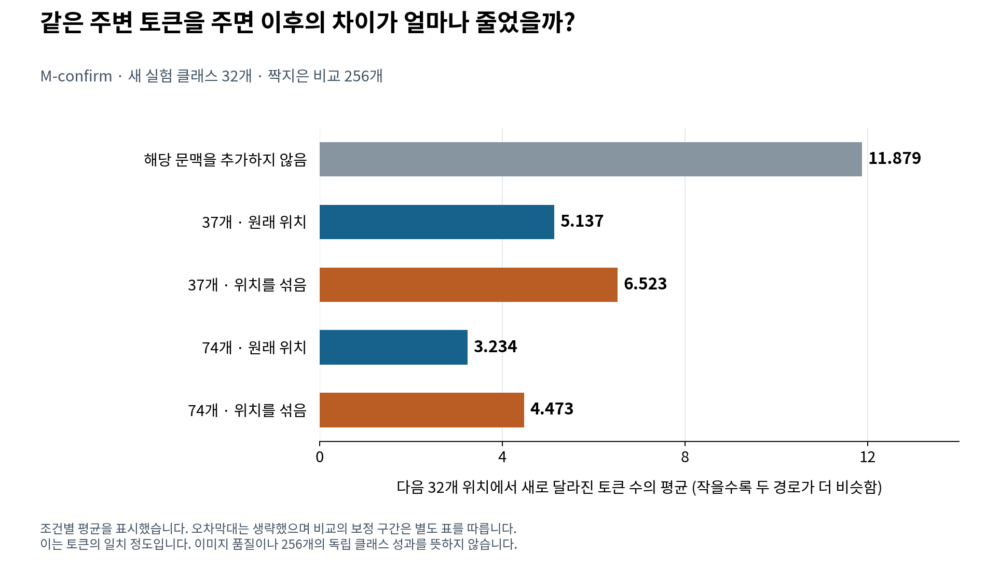
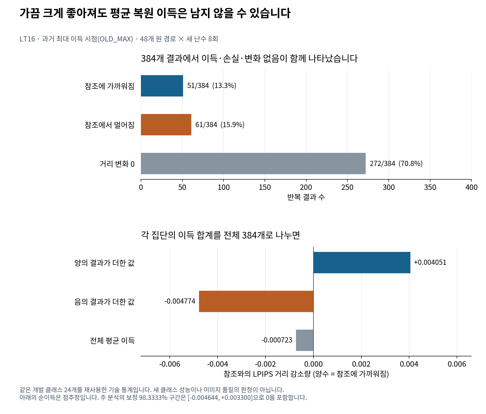

# FDCA · 연구 질문을 통제 실험과 검증 가능한 기록으로 바꾸기

**Munsik Kim** · [한국어 소개](../README_KO.md) · [쉬운 설명](../START_HERE_KO.md) · [English](../README.md)

## 어떤 문제를 다룬 작업인가

AI 모델 내부의 작은 수치 근사가 최종 결과에 미치는 영향을 조사했습니다. 첫 토큰 차이의 발생과 그 뒤의 전파를 분리하고, 중요한 블록·시점을 알면 제한된 정밀도 복원을 유리하게 배치할 수 있는지 시험했습니다.

이 작업은 **문제 정의 → 비교 설계 → 모델 개입 → 수치 분석 → 반복 검산 → 다음 실행 여부 결정**을 연결한 연구 포트폴리오입니다. 전파·문맥 효과는 확인했고, 시험한 복원 정책의 안정적 우위는 확보하지 못했습니다. 결과를 바탕으로 확대를 멈춘 결정과 재개 조건도 공개했습니다.

## 구현·설계와 실제 확인 위치

| 작업 | 구현·기록 | 확인할 수 있는 범위 |
|---|---|---|
| 최초 불일치 사건과 이후 결과 분리 | [first_divergence.py](../fdca/core/first_divergence.py), [consequence.py](../fdca/core/consequence.py) | 유한한 합성 모델의 정확한 경로 계산. 임의의 실전 모델을 자동 감사하는 제품 기능은 아님 |
| 시각 생성 실험의 조건부 결합 추출 | [p2n_conditional_maximal.py](../fdca/couplings/p2n_conditional_maximal.py) | 정해진 분포·조건 아래의 비교 추출 구현 |
| 사건별 난수 주소와 반복 가능성 | [p2p_event_addressed.py](../fdca/rng/p2p_event_addressed.py), [semantic_key_registry.py](../fdca/rng/semantic_key_registry.py) | 비교 실험에서 어떤 난수 사용을 대응시키는지 기록·관리 |
| 모델 어댑터의 실험 계약 | [halton_maskgit_contract.py](../fdca/adapters/halton_maskgit_contract.py) | 스케줄과 인터페이스 계약. 모든 11월 GPU 실행 코드의 공개를 뜻하지 않음 |
| 기존 원 논문 수치의 재계산 | [reproduce_public_results.py](../scripts/reproduce_public_results.py) | 원 공개 결과의 지정 집계·검사 |
| 후속 실험의 수치 재생 | [replay_public_evidence.py](../research/followup_2026_11/scripts/replay_public_evidence.py) | M-confirm, R-test/LT10, LT16의 공개 숫자·짝짓기·bootstrap 구간 |
| 독립 계산 경로 | [independent_statistics_lt16.py](../research/followup_2026_11/evidence/lt16/independent_statistics_lt16.py) | 별도 구현으로 저장 scalar 4,653개 대조. 외부 연구기관의 재현이나 모델 재실행을 뜻하지 않음 |
| 실험의 성공·실패·미실행 상태 추적 | [실험 ledger](../research/followup_2026_11/data/experiment_ledger.csv), [실패 분석](../research/followup_2026_11/FAILURE_ANALYSIS_KO.md) | 표본 재사용, 목표 변경, 개발 기준 실패와 보류 결정 |
| 숫자와 그림의 연결 | [원 그림 생성](../research/followup_2026_11/scripts/build_figures.py), [설명 그림 생성](../research/followup_2026_11/scripts/build_explainer_figures.py) | 기존 표에서 그림으로 이어지는 입력·계산·출처 |

## 연구 판단이 드러나는 세 장면

### A. “중요한 위치”와 “유리한 개입”을 따로 시험

초기 pulse가 최종 차이를 크게 만든다는 LT3·LT4 결과 뒤에, 실제 복원 정책 LT5·R-test를 별도로 평가했습니다. 전파 점수가 컸다는 이유만으로 복원 성공을 발표하지 않았습니다. 320개 새 클래스의 확인 실험과 원래 개발 자료를 구분하고, 같은 행동을 고른 정책 이름을 독립된 성과로 세지 않았습니다.

[설계와 결과](../research/followup_2026_11/REPORT_KO.md) · [추정량 정의](../research/followup_2026_11/METHODS_KO.md)

### B. 주변 정보를 바꾸는 통제 실험

공통 문맥의 존재뿐 아니라 같은 값의 배치, 가시 범위, 다른 출처의 문맥을 비교했습니다. M-confirm의 가시 범위 효과가 두 배치 조건의 평균이라는 식을 공개하고, 표본을 재사용한 실험과 새 클래스 확인을 구분했습니다.

이 설계는 단순 상관 관측보다 질문을 좁혀 줍니다. 효과가 확인된 대상은 지정한 상태·스케줄·결합에서의 후속 토큰 불일치입니다. 모델의 의미 이해나 이미지 품질 전체로 확대하지 않습니다.

### C. 최대 관측값을 검증 가능한 정책 가치와 구분

한 번의 실행에서 가장 좋은 시점을 골랐을 때의 큰 이득을 그대로 다음 실험의 근거로 쓰지 않고, LT16의 저장 상태·새 난수 반복으로 점검했습니다. 양의 결과, 음의 결과, 변화 없는 결과를 함께 집계하고, 선택과 평가 난수를 나눈 진단을 보존했습니다.

개발 기준을 통과하지 못한 LT15는 실행하지 않았습니다. 이 결정은 검산 통과와 알고리즘 성공을 구분하고, 확인용 표본을 다음 가설에 무분별하게 소비하지 않는 연구 운영의 일부입니다.

## 기존 구성요소와 프로젝트 기여

| 구성요소 | 출처·역할 | 이 프로젝트에서 한 일 |
|---|---|---|
| H-MaskGIT 생성기, VQ 이미지 디코더 | 사전학습 모델과 기존 구조 | 지정 가중치·상태·문맥에 개입하는 비교와 분석 |
| LPIPS·DINO 등 평가 구성요소 | 기존 특징·거리 지표 | 차이의 측정과 집계. 사람 평가 정답으로 취급하지 않음 |
| NumPy·Matplotlib·Python·GitHub Actions | 수치 계산·그림·검사 도구 | 재생 코드, 공개 데이터 연결, CI 구성 |
| 최초 분기 연구와 후속 실험 | 본 저장소의 연구 기록 | 가설·대조·추정량 정의, 구현과 감사, 보고서·실패 분석 |

정확한 외부 자산 revision·hash·권리는 [자산 등록부](EXTERNAL_ASSET_REGISTRY.md), [외부 구성요소 안내](../THIRD_PARTY_NOTICES.md), [라이선스 범위](../LICENSE_SCOPE.md)를 따릅니다. 모델 자체를 처음부터 학습하거나 모든 이론·수치 도구를 새로 발명했다는 소개가 아닙니다. 코드·분석·문서의 작성과 정리에는 AI 도구의 지원이 사용됐으며, 재현 가능한 코드와 저장 근거로 결과를 확인할 수 있게 했습니다.

## 공개 재현물의 범위

| 확인 방법 | 실제 수행하는 일 | 수행하지 않는 일 |
|---|---|---|
| 저장소 검사·158개 테스트 | 공개 파일·코드 계약·합성 모델 계산, 보조 통계의 반올림·오류 거부 검사 | 원 신경망 전체 실험의 재수행 |
| 후속 수치 재생 | 선택된 공개 근거 파일 68개 해시, 대비·구간·LT16 표와 scalar 검산 | 새 GPU 추론, 새 이미지 생성, 새 LPIPS 계산 |
| 그림 재생 | 저장 측정값의 평균·부호별 집계와 원 구간 표시 | 새 추정량 선택·추가 통계 검정 |
| 전체 GPU 재현 | 외부 모델·자료·원 실행 환경이 필요 | 이번 공개 compact만으로 모두 보장되지 않음 |

LT6 단독 compact와 일부 전체 실행 자료를 확보하지 못한 부분은 [검증 범위](../research/followup_2026_11/EVIDENCE_AND_VALIDATION.md)에 남겼습니다. 공개되지 않은 부분을 독자가 재현할 수 있다고 소개하지 않습니다.

## 다른 포트폴리오와 연결되는 지점

- **[DIOVA](https://github.com/Munsik-Kim/inference-lab):** 모델을 바꿀 때 같은 질문의 답·업무 완료 상태·실행 비용을 비교합니다. FDCA는 그 문제의식을 시각 토큰 생성의 내부 경로와 통제 개입으로 좁힌 연구입니다.
- **[Inference Engineering Kit](https://github.com/Munsik-Kim/inference-engineering-kit):** 지원하는 과제와 입력·정답 계약을 갖춘 평가 도구입니다. FDCA는 지정한 생성 모델을 연구한 기록이며 같은 범위의 설치형 평가 제품은 아닙니다.
- **[Teacher Error Geometry Lab](https://github.com/Munsik-Kim/teacher-error-geometry-lab):** 교사와의 일치와 실제 목표에 대한 오차를 구분하고 이론·수치 결과를 대조합니다. FDCA 역시 참조 거리·토큰 일치·이미지 품질을 별개로 정의합니다.
- **[Direction–Scale Archive](https://github.com/Munsik-Kim/direction-scale-archive):** 제한된 이론 결과와 실제 모델의 미확정·부정적 결과를 함께 보존합니다. FDCA도 전파 결과와 복원 정책의 실패를 각 가정·조건에 맞춰 기록합니다.

이 연결은 작업 방식과 문제의식의 비교입니다. 서로 다른 모델·데이터·지표를 사용한 결과를 하나의 공통 성능 점수로 비교하지 않습니다.

## 검토자가 짧게 확인할 순서

1. [입문 설명](../START_HERE_KO.md)에서 연구 질문과 세 종류의 측정을 확인합니다.
2. [원 비교표](../research/followup_2026_11/evidence/tables/m_confirm_contrasts.csv)와 [LT16 주 결과](../research/followup_2026_11/evidence/lt16/expected/primary_contrasts.csv)를 그림·본문과 대조합니다.
3. [재생 명령과 범위](../research/followup_2026_11/EVIDENCE_AND_VALIDATION.md)에 따라 공개 수치를 계산합니다.
4. [실패 분석](../research/followup_2026_11/FAILURE_ANALYSIS_KO.md)에서 직접 지지된 원인과 아직 가설인 설명을 나눠 봅니다.
5. [다음 연구 기준](../research/followup_2026_11/NEXT_RESEARCH_KO.md)에서 무엇이 새로 입증돼야 재개하는지 확인합니다.
