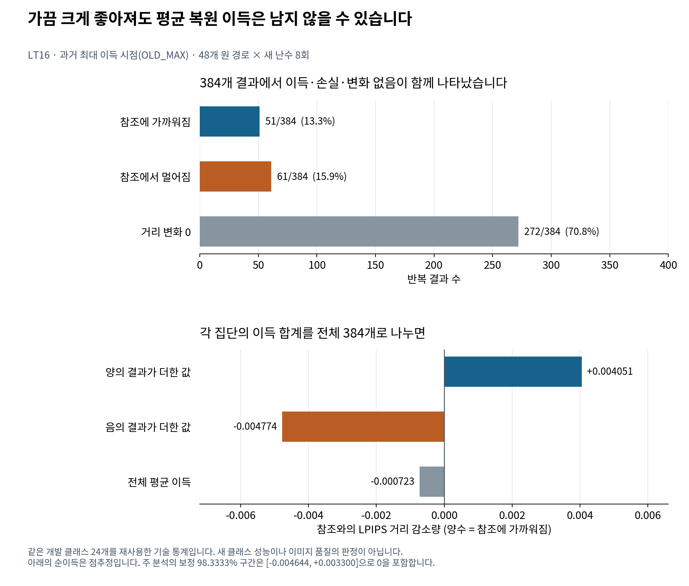

# 복원 정책은 어디에서 실패했는가

[전체 보고서](REPORT_KO.md) · [정확한 실험 정의](METHODS_KO.md) · [후속 연구 기준](NEXT_RESEARCH_KO.md)

[입문 설명](../../START_HERE_KO.md)은 가중치·토큰·참조 거리·신뢰구간을 먼저 설명합니다. 아래의 실패는 지정한 정책 목표와 비교 조건에 대한 판정이며, 원인으로 직접 확인한 내용과 아직 가설인 설명을 구분합니다.

## 결론을 정확히 제한하기

실패한 목표는 **참조 정보 없이 현재 상태로 복원 시점·block을 선택하여, 같은 예산의 강한 기준 정책보다 FP32 참조와의 LPIPS 거리를 안정적으로 더 줄이는 것**이다. 전파가 존재한다는 가설 전체가 반증된 것도, 모든 정밀도 복원이 무의미하다고 증명된 것도 아니다.

| 판단 | 근거 | 판단하지 않은 것 |
|---|---|---|
| 현재 FDCA 예산 정책의 성공을 확인하지 못함 | LT5 공동 주 구간 두 개와 R-test 여섯 개가 0 포함 | 모든 가능한 정책의 G=0 |
| LT14 제안의 다음 단계 진행 기준 실패 | ENTROPY 대비 +0.000618 < 사전 +0.005 | 미실행 LT15의 성능 |
| 원 경로의 최대 이득은 낙관적 개발 신호 | LT16에서 OLD_MAX가 +0.05806에서 −0.00072로 변화; split-half 선택/평가 분리 | 원 값 조작, 구현 실패, 모든 oracle 효과 부재 |
| 현 특징의 추가 가치에 제한적 부정적 근거 | 제안−시간만 사용 CI가 ±0.005 내부 | 모든 상태 특징이 무가치 |
| 현 복원 노선의 반복 확대는 우선순위가 낮음 | 지속 복원→예산 복원→적응 복원→새 난수 진단의 누적 결과 | 다른 행동·모델·목표까지 연구 금지 |

## 1. sensitivity를 benefit으로 잘못 연결하기 쉬웠다

FDCA의 pulse R은 근사로 인해 두 경로가 얼마나 달라지는지 측정한다. 큰 R은 큰 **영향의 크기**다. 반면 복원 정책은 그 변화가 FP32 참조에 가까워지는 방향인지 알아야 한다. 국소 TV 역시 law의 차이를 측정하며, 좋은 이미지나 참조 방향을 직접 부호화하지 않는다.

가중치 하나를 더 정확히 바꿔도 이미 W8에서 만들어진 prefix 상태, 다른 W8 block, 다음 categorical 추출, 공통 참조와의 결합이 함께 작용한다. 복원이 국소 law를 바꾸지만 최종 경로는 더 멀어질 수 있다. **이 설명은 구조적으로 가능한 메커니즘이며, 현재 자료가 각 원인의 기여율을 분리해 증명한 것은 아니다.**

실제로 LT2의 block 3 국소 복원 이득은 block 2보다 컸지만, 최종 pulse 차이는 미확정이었다. LT3/LT4의 초기 pulse R은 반복해서 컸지만 LT5의 초기 복원 정책은 확인되지 않았다. 이 연결 실패가 “전파 결과가 틀렸다”보다 자료에 잘 맞는 설명이다.

## 2. 단일 난수 최대값이 학습 가능한 기대 이득처럼 보였다

LT14는 원 경로별 32개 시점의 결과를 보고 가장 큰 G를 고르면 평균 +0.0580628을 얻었다. 이 값은 **결과를 본 뒤의 최대 관측값**이다. 시점이 좋은 상태여서가 아니라 그 시점의 특정 난수 실현이 우연히 유리해서 최대가 될 수 있다.

간단히 관측 이득을 `G_hat(s)=mu(s)+noise(s)`라고 쓰면, 같은 데이터에서 최대를 고를 때 noise가 양수인 후보가 선택되기 쉽다. 따라서 `max G_hat`은 정책이 얻을 수 있는 `max mu`의 검증된 추정치가 아니다. LT16은 그 차이를 직접 점검했다.

| LT16 진단 | 추정치 | 구간/범위 |
|---|---:|---|
| OLD_MAX의 새 평균 G | −0.0007234 | 주 98.3333% [−0.0046438, +0.0033003] |
| OLD_MAX 새 값−원 값 | −0.0587862 | 보조 95% [−0.0783603, −0.0422861] |
| 난수 절반으로 선택하고 같은 절반에서 평가 | +0.0091272 | 선택에 사용한 표본 내 값 |
| 다른 절반에서 선택 시점을 평가 | −0.0012947 | 보조 95% [−0.0039984, +0.0013292] |
| 위 두 값의 paired 차이 | +0.0104219 | 보조 95% [+0.0069633, +0.0143014] |

두 절반의 선택 시점이 같은 부모는 13/48이었다. 부모별 후보 수는 2–5개로 다르고 동률도 있으므로 이 일치율을 무작위 기준과 검정한 결과처럼 말하지 않는다. 반복은 원 저장 상태에 조건화되어 있고 원 시점 선택도 고정한다. 새 클래스나 처음부터 실행하는 온라인 정책으로 일반화하지 않는다.

**가장 강하게 뒷받침되는 원인 분석은 선택 낙관성이다.** 원 최대값이 새 반복에서 유지되지 않았고, 선택·평가를 같은 반복에서 수행하면 값이 커지는 현상을 같은 실험 내에서 관측했다. 이 결과는 평균 이득이 정확히 0임을 입증하지 않지만, +0.058 수준의 개발 여지가 그대로 실재한다는 기대를 지지하지 않는다.

## 3. 현재 특징이 시간 정보보다 나은가

LT14는 현재 W8 law의 margin·entropy와 변화량 특징을 사용했다. LT16의 `PROPOSED−TIME_ONLY`는 +0.0001618이며 주 CI는 [−0.0002543, +0.0010123]다. 전체 구간이 사전 ±0.005 범위 안에 있다. 두 선택 규칙은 48부모 중 41개에서 같은 시점을 골랐다.

선택된 상태 부분집합에서 새 평균 G를 예측한 MSE는 상태 특징 모델 0.00022687, 시간만 사용한 모델 0.00017483이었다. 차이 +0.00005204의 보조 95% CI는 [+0.00000260, +0.00014341]이다. 원 학습값의 높은 적합도가 새 난수의 평균 이득 예측으로 이어지지 않았다. 이 분석은 선택된 158상태에 한정되며 전체 상태 공간이나 다른 표현의 성능을 평가하지 않는다.

## 4. 희소 변화와 양·음 이득의 상쇄

그림의 아래 패널은 집단별 G의 합계를 전체 384개로 나눈 값입니다. 이득이 난 결과만 골라 평균한 값과 다릅니다. 384개는 24개 개발 클래스의 48개 부모에서 얻은 반복 결과이며 독립 클래스 수가 아닙니다.

OLD_MAX의 48부모×8반복=384개 결과 중 양의 G는 51개, 음의 G는 61개, 0은 272개였다. 양의 경우 평균은 약 +0.03050, 음의 경우 평균은 약 −0.03005였다. 가끔 큰 이득이 존재해도 비슷한 크기의 손실과 많은 무변화가 평균에서 상쇄될 수 있다.

LT16의 OLD_MAX 요약은 다음 항등식을 만족한다.

| 관측 상태 변경에 대한 표본 분해 | 값 |
|---|---:|
| H: 변경 빈도의 부모 평균 | 0.291667 |
| M_equal: 변경 시 signed G의 부모 평균 | +0.006388 |
| H×M_equal | +0.001863 |
| covariance, ddof=0 | −0.002587 |
| 평균 G | −0.000723 |

`H×M_equal`만 보면 부호마저 잘못 읽을 수 있다. 그러나 이 분해는 기술 통계다. covariance가 음수인 이유를 특정 network 메커니즘으로 확정하거나, 변경 빈도를 maximal pair TV라고 해석하지 않는다.

## 5. 반드시 보존해야 하는 반례와 양의 결과

부정적 결론을 만들기 위해 긍정적 결과를 지우면 안 된다.

- **LT1-R:** block 3 선택은 uniform 평균보다 +0.047105, 탐색적 95% [+0.014383, +0.080723]이었다. 다만 8개 재사용 개발 클래스에서 local TV·단일층 민감도·FDCA가 모두 block 3을 선택했다. FDCA만의 추가 가치나 독립 확인이 아니다.
- **LT12:** 참조에서 알아낸 최초 불일치 시점에 block 2를 한 번 복원했을 때 G=+0.017311, 보정 98.75% [+0.000361, +0.035429]였다. 양의 방향은 확인됐고, 실용 경계 +0.01을 구간 하한이 넘지는 않았다. “복원에서 양의 결과가 전혀 없다”는 주장은 사실과 다르다.
- **LT12 참조 토큰 편집:** G=+0.080290, 대체 토큰 편집 대비 +0.079728로 큰 효과였다. 그러나 위치와 방향을 FP32 참조에서 얻는 oracle 개입이다. 실행 가능한 참조 없는 탐지·수정 알고리즘의 결과가 아니다.
- **LT13:** 원 난수에서 자기 최초 불일치 시점은 교환 시점보다 +0.014858 유리했다. 새 난수 8쌍에서는 방향 미확정이었다. 표본과 조건이 다르므로 부호 반전만으로 두 효과의 차이를 검정했다고 말할 수 없다.

LT12의 조건부 양의 결과와 LT16의 부정적 진단은 같은 가설·같은 표본의 재현 실패로 단순 대응하지 않는다. 전자는 참조에서 정한 최초 불일치 시점, 후자는 개발 자료의 여러 선택 규칙이 고른 저장 상태에서의 새 난수다. 둘을 함께 보면 **개입이 도움이 될 수는 있지만 도움이 되는 상태·방향을 참조 없이 찾는 문제가 남아 있다**고 해석하는 것이 적절하다.

## 6. “표본이 작아서”만으로 설명할 수 있는가

초기 8클래스 결과의 넓은 구간은 표본 제한의 영향을 크게 받는다. 그래서 R-test는 새 320클래스, 640단위로 확대했다. 여섯 주 구간은 여전히 0을 포함했다. F의 구간은 실용 이득도 허용하므로 무효를 확정할 수 없지만, S의 두 구간은 ±0.01 안에 있다. LT16도 A의 상한이 +0.01 아래이고 C의 전체 구간이 ±0.005 안에 있다.

따라서 결론은 모두가 동일하게 “정보 부족”인 것은 아니다. 일부 효과는 아직 폭넓게 미확정이고, 일부 지정 대비에서는 사전 크기의 이득을 뒷받침하지 않는 정밀도가 확보되었다. 반복 수를 늘리면 MCSE는 줄어들 수 있지만 기대 이득 자체나 참조 없는 식별 능력이 생기지는 않는다.

## 7. 아직 원인으로 확정하지 못한 것

| 후보 설명 | 현재 근거 | 분리하려면 필요한 실험 |
|---|---|---|
| 이미 달라진 prefix가 일회 복원의 효과를 제한 | 복원은 Q의 현재 상태를 이어받는 구조 | 고정 상태에서 prefix 정렬 여부와 동일 복원 행동의 factorial 비교 |
| 다른 W8 block이 복원 효과를 상쇄 | 한 block 외 41개 대상 행렬은 여전히 W8 | 제한된 다중 block 개입과 동일 비용 대조; 현재 자료로 기여율 단정 금지 |
| 참조와의 결합이 결과를 좌우 | R-alt/LT10의 결합 민감도 일부 보조 신호 | 사전 지정 joint law별 충분한 독립 반복; marginal 품질 지표 별도 |
| 현재 특징이 signed value를 담지 못함 | 제안−시간 차이 작음, 새 평균 예측 MSE 열세 | 독립 난수 평균 label, 새로운 특징을 사전 제한한 cross-fitting |
| quantizer 방식에 특화된 현상 | 동일 W8 RTN 조건 중심 | 다른 quantizer를 별도 가설로 평가; 현재 실패 설명으로 사후 단정 금지 |
| LPIPS가 원하는 품질과 다름 | 목표 자체가 참조 거리 | 품질을 목표로 바꿀 때 별도 데이터·지표·평가 설계 |

## 8. 다음 연구에 남길 실패 기록

현재 상태는 **복원 알고리즘 성공 미입증, 개발 gate 실패, LT15 미실행**이다. LT15 예약 265클래스를 열지 않은 것은 선택 편향을 늘리지 않고 다음 독립 확인 기회를 보존한 결정이다. 데이터가 충분히 검산되었다는 사실은 과학적 가설이 확인되었다는 뜻이 아니다.

다음 개발자는 단일 경로의 최대 이득으로 학습 가능성을 주장하지 말아야 한다. 선택 난수와 평가 난수를 분리하고, signed 평균 G와 무개입 정책을 함께 평가하며, 같은 행동·정보·비용의 기준 정책을 먼저 이겨야 한다. 이러한 조건을 만족하지 못하면 모델이나 표본만 확대하기보다 연구 목표와 행동 공간을 다시 정의하는 편이 타당하다.
