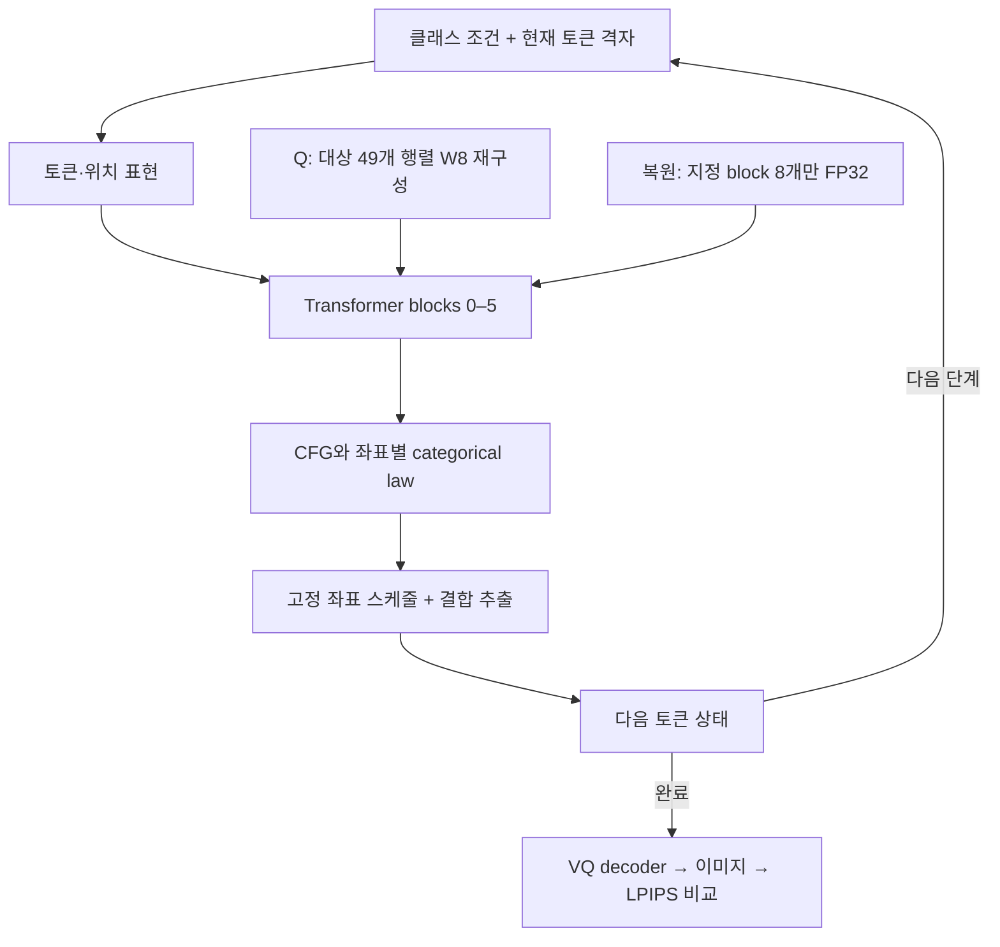
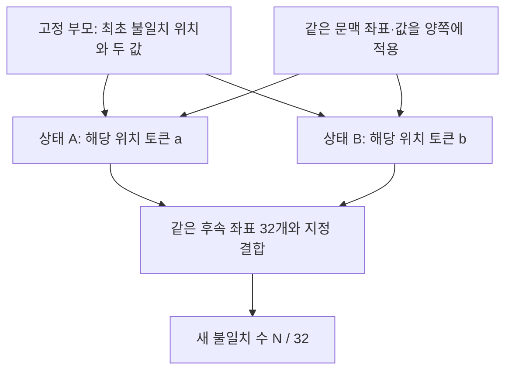

# 모델 구조, 개입, 비교군과 통계 정의

[포트폴리오](README.md) · [전체 연구 보고서](REPORT_KO.md) · [근거와 검증](EVIDENCE_AND_VALIDATION.md)

## 1. 무엇을 실행했는가

11월 후속 연구의 중심 모델은 **H-MaskGIT-T**다. 클래스 조건을 받아 마스킹된 시각 토큰을 채우고, 완성된 토큰 배열을 VQ decoder로 이미지로 바꾸는 생성기다. 여기서 토큰은 단어가 아니라 학습된 이미지 코드북의 인덱스다. 원 논문의 Tiny/Small 비교 전체와 후속 Tiny 실험을 같은 표본으로 취급하지 않는다.

| 요소 | 후속 실험의 고정 설정 또는 의미 |
|---|---|
| 생성기 | H-MaskGIT-T, Transformer block 6개, 인덱스 0–5, hidden width 384 |
| 시각 토큰 격자 | 16×16, 256좌표 |
| categorical support | 16,385개 값; MASK 인덱스 16,384 포함 |
| 생성 스케줄 | 고정된 Halton 좌표 순서와 32단계, CFG 3 |
| FP32 경로 P | 생성기의 대상 가중치를 원 FP32 값으로 실행 |
| all-W8 경로 Q | 대상 49개 행렬을 per-output-channel 대칭 W8 RTN으로 양자화한 뒤 FP32로 재구성하여 실행 |
| 복원 경로 | Q에서 지정한 block의 8개 행렬만 원 FP32 값으로 바꿔 지정 단계에 실행 |
| 대상 밖의 요소 | decoder, LPIPS 계산, 활성값 정밀도는 해당 생성기 가중치 복원과 구분 |

**W8은 이 실험에서 실제 packed INT8 커널을 뜻하지 않는다.** 가중치 근사에 따른 확률분포와 경로의 변화를 연구한다. 실행 시간이나 VRAM의 배포상 이득을 입증한 실험이 아니다. 원 계획의 per-tensor 기술과 실제 per-output-channel 실행 차이는 v1.0.1 정정의 deviation으로 보존한다.

이 그림은 적용 위치를 보여주는 구조도다. 내부 정규화·잔차·attention의 모든 연산을 생략 없이 구현한 계산 그래프는 아니다.

## 2. block 2를 복원한다는 뜻

[실행 계약에서 추출한 행렬 목록](data/block2_restored_tensors.csv)의 합은 2,654,208개 파라미터다. block 2는 0부터 세면 세 번째 Transformer block이다.

| 경로 접미부 (`transformer.layers.2.` 뒤) | 크기 | 파라미터 수 |
|---|---|---:|
| `mlp.1.weight` | 2304×384 | 884,736 |
| `attn.wq.weight` | 384×384 | 147,456 |
| `attn.wk.weight` | 384×384 | 147,456 |
| `attn.wv.weight` | 384×384 | 147,456 |
| `attn.wo.weight` | 384×384 | 147,456 |
| `ff.w1.weight` | 1024×384 | 393,216 |
| `ff.w2.weight` | 384×1024 | 393,216 |
| `ff.w3.weight` | 1024×384 | 393,216 |

`mlp.1`은 조건/modulation 투영이며 `ff.w1`과 구분한다. 대상은 여섯 block의 8개 행렬씩과 `last_norm.mlp.1.weight`의 합인 49개다. 한 block을 복원하는 순간에도 나머지 41개 대상 행렬은 W8 상태다.

| 개입 종류 | 바꾸는 것 | 비교에서 답하는 질문 |
|---|---|---|
| LT1 단일 block 양자화 | FP32 생성기에서 한 block만 지속 W8 | 어느 block의 지속 근사가 전체 출력 차이와 연관되는가? |
| LT1-R 지속 복원 | all-W8에서 한 block을 32단계 내내 FP32 | 한 block 전체를 복원하면 참조와 가까워지는가? |
| LT2C–LT4 single pulse | 지정 상태·단계에서 두 law를 달리하고 이후 공통 W8 실행 | 한 번의 차이가 발생할 기회와 그 이후 결과는 얼마나 큰가? |
| LT5/R-test 예산 복원 | 한 block을 정해진 8단계에서만 FP32 | 같은 block-step 예산을 어디에 쓰는 것이 좋은가? |
| LT12–LT16 one-step 복원 | 선택 시점 한 번만 block 2 또는 3 FP32 | 시점을 알아내거나 예측해서 얻을 수 있는 signed gain이 있는가? |
| LT6/M/LT11 문맥 개입 | 두 상태의 공통 가시 좌표와 그 토큰 값 | 같은 최초 불일치의 후속 전파가 공통 문맥에 따라 달라지는가? |
| LT12 토큰 편집 | 최초 불일치 위치를 참조 토큰 또는 대체 토큰으로 변경 | 수정 방향을 참조에서 알 때 그 토큰이 이후 차이에 기여하는가? |

8단계 복원의 예산은 2,654,208×8 = **21,233,664 parameter-step**이다. 이 값이 같다고 실제 wall time, 메모리 이동, 탐지 비용까지 같아지는 것은 아니다.

## 3. 두 경로와 공통 토큰

“두 경로”는 같은 클래스 조건에서 생성되는 두 개의 토큰 상태 열이다. 복제된 상태가 어느 좌표에서 서로 다른 토큰을 얻으면, 그 차이가 다음 확률분포의 입력이 된다. 이후 차이가 커질 수도, 사라질 수도 있다. 최초 불일치는 사람이 판정한 오류가 아니라 **두 실행이 처음 다른 categorical 값을 고른 사건**이다.

문맥 실험에서는 최초 불일치 위치와 두 값을 고정한다. 그 외 지정한 좌표에 기록된 동일한 토큰을 두 상태 모두에 채운다. 이것이 공통 문맥이다. 두 경로의 최초 다른 토큰을 같은 값으로 만드는 개입과 다르며, 참조 토큰으로 정답을 채운다는 뜻도 아니다.

M-confirm에서는 다음 다섯 조건을 같은 짝에서 비교했다. H/L은 높은/낮은 가시 범위이고, FP32/W8의 높고 낮은 정밀도를 뜻하지 않는다.

| 조건 | 추가 공통 문맥 | 역할 |
|---|---|---|
| SPARSE | 해당 문맥을 채우지 않음 | 문맥 추가의 기준 |
| REAL_H | 기록된 74개 값을 원래 좌표에 배치 | 높은 가시 범위, 원래 배치 |
| SHUF_H | 동일한 값의 집합을 정해진 순열로 섞어 동일 가시 좌표에 배치 | 가시 범위와 값 집합을 맞춘 배치 대조 |
| REAL_L | 낮은 범위 37좌표, 원래 배치 | 문맥 양 비교 |
| SHUF_L | 낮은 범위 37좌표, 섞은 배치 | 문맥 양 효과와 배치 효과의 구분 |

주 대비는 다음과 같다. Y는 32좌표에서 새로 다른 토큰의 비율이다.

$$
C_{ctx}=Y_{SPARSE}-Y_{REAL_H},\quad
C_{layout}=Y_{SHUF_H}-Y_{REAL_H}.
$$

$$
C_{dose}=\tfrac12\{(Y_{REAL_L}-Y_{REAL_H})+(Y_{SHUF_L}-Y_{SHUF_H})\}.
$$

**C_dose는 두 배치 조건에 걸쳐 평균한 가시 범위 효과다.** REAL 조건만의 차이 1.90234개와 주 결과 1.97656개를 혼동하면 안 된다. 또한 `C_ctx = C_shuffle + C_layout`은 같은 단위에서 정확히 성립하는 분해다. 두 항이 독립이라는 뜻은 아니다.

LT11의 출처 교환은 다른 클래스 부모에서 가져온 문맥을 수신 쌍의 두 경로 모두에 동일하게 넣는다. 서로 다른 두 문맥을 두 경로에 각각 주는 실험이 아니다. 출처가 다른 공통 문맥도 효과가 있으며, 자기 출처가 더 유리한지를 따로 비교한다. 토큰 값, 공간 배치, 수신 상태와의 적합성이 함께 바뀌므로 “의미 정보만의 인과효과”로 해석하지 않는다.

## 4. coupling은 비교 실험의 일부다

같은 난수를 쓴다는 말만으로 결합을 특정할 수 없다. 두 marginal law가 정해져도 이를 함께 추출하는 joint law는 여럿이다. LPIPS의 경로 간 평균 거리는 그 결합에 의존할 수 있다.

단일 shock의 좌표별 maximal coupling은 한 좌표의 불일치 확률을 두 categorical law의 total variation과 같게 한다. 좌표 간 독립 결합을 적용한 고정 batch에서는 하나 이상 갈라질 확률이 다음과 같다.

$$
h=1-\prod_{j\in batch}(1-TV_j).
$$

LT2C 이후 조건부 추출은 이 batch 사건이 발생했다는 조건에서 suffix를 전개하고, 원 발생 확률 h로 다시 가중한다. 조건부 표본이 모두 갈라졌다고 자연 발생률 H가 1인 것은 아니다. batch에서 최초 seed 불일치가 여러 좌표일 수도 있다.

복원 실험은 참조 P를 중심으로 Q와 복원 경로를 연결하는 **reference-anchored star coupling**을 사용한다. P–Q 및 P–복원 쌍의 maximal 성질이 Q–복원 쌍까지 maximal임을 보장하지 않는다. LT16에서 관측한 Q–복원 상태 변경 빈도를 곧바로 두 law의 TV로 부르면 안 된다. R-alt의 common inverse-CDF 대조는 이 결합 민감성을 진단한 것이며, 모든 결합에 걸친 불변성을 보인 것이 아니다.

## 5. 전파량과 복원 이득은 다른 목표다

고정 부모 i에서 불일치 사건 확률 h_i, 사건이 발생했을 때 두 경로의 출력 discrepancy 기대값 m_i를 둔다. pulse 연구의 m_i는 비음수 거리다.

$$
H=\overline h,\quad M_{equal}=\overline m,\quad
R=\overline{hm}=H M_{equal}+\operatorname{Cov}_{ddof=0}(h,m).
$$

H>0일 때 `M_split=R/H`는 split 확률로 가중한 조건부 결과다. `M_equal`과 같은 양이 아니다. H=0에서는 이 비율이 정의되지 않는다. 평균 곱으로 R을 대체하거나 covariance를 누락하지 않는다. v1.0.1은 이 구분과 block별 대칭 attribution 후 평균을 명시한 정정이다.

복원 연구의 목표는 다음 **부호 있는** 이득이다.

$$
G=\operatorname{LPIPS}(I_P,I_Q)-\operatorname{LPIPS}(I_P,I_{restore}).
$$

G>0은 지정된 참조 경로와의 거리가 줄었음을 뜻하고 G<0은 늘었음을 뜻한다. R이 크다는 것은 바꿨을 때 영향이 클 수 있다는 뜻이다. 그 영향이 참조를 향하는지는 별도 문제다. 또한 참조 P도 stochastic sample이지 사람의 지각적 정답 이미지가 아니다.

LT16의 h·m 분해는 **관측한 post-state 변경 빈도**와 **변경 시 signed G 평균**이다. 같은 기호를 쓰더라도 앞의 자연 shock 확률·비음수 pulse discrepancy와 다른 추정량이다. 변경이 0번인 상태의 표본 m=0은 계산상 convention이며, 모집단 조건부 효과가 0이라는 증거가 아니다.

## 6. 표본, 신뢰구간, MCSE

클래스 안에서 부모·반복·조건을 먼저 대응시켜 평균하고, 클래스 또는 설계된 클래스 쌍을 bootstrap 단위로 삼는다. 같은 부모의 여러 suffix draw와 정책 alias를 독립적인 새 클래스로 세지 않는다. LT16은 240개 selector 참조가 158개 고유 상태를 가리키고, 상태당 8draw가 있으므로 실제 고유 실험은 1,264개다. selector로 펼친 1,920행은 추가 표본이 아니다.

| 단계 | 보고하는 구간 | 해석 |
|---|---|---|
| LT1-R, LT2, LT2C, LT13 | 탐색적 95% | 공동 확인 결과로 격상하지 않음 |
| LT3, LT4, LT5 | 두 공동 주 대비별 97.5% | Bonferroni family 2 |
| M-confirm, LT16 | 세 주 대비별 98.3333% | Bonferroni family 3 |
| R-test | 여섯 주 대비별 99.1667% | Bonferroni family 6; alias도 원 family 유지 |
| LT10 | 13개 사후 대비별 99.6154% | 사후 family 13; 원 95%도 보조자료로 보존 |
| LT11 | 두 주 대비별 97.5% | 클래스 쌍 단위 |
| LT12 | 네 주 대비별 98.75% | 참조 정보를 사용한 재사용 표본 진단 |

공개 재생 대상은 20,000회 paired bootstrap, PCG64, linear quantile을 원 설정대로 복원한다. 원 논문의 20,000/higher와 v1.0.1의 100,000/linear 사후분석은 별개이며, 새로운 구간으로 덮어쓰지 않는다. 단계마다 family가 다르므로 전체 연구 프로그램에 대한 일괄 family-wise 보장이 있다고 주장하지 않는다.

LT16의 고정 부모 MCSE는 먼저 상태 내 paired draw 차이의 분산을 쓰고, 48개 부모와 K=8의 평균으로 전파한 값이다. 클래스 bootstrap CI와는 다른 불확실성이다. 둘을 임의로 더해 “더 정확한 하나의 CI”로 만들지 않는다. CI가 0을 포함하면 방향이 미확정이며, 전체 구간이 미리 정한 실용 범위 안에 있는 경우에만 그 범위에서의 작은 효과라는 제한된 해석이 가능하다.

## 7. 정책 실행 비용에서 빠뜨리지 말 것

LT14 제안 정책의 참조 없는 기술 실행은 Q 32회와 R2 1회를 사용했다. 고정 시점 정책은 해당 Q 호출을 대체하여 Q 31회와 R2 1회로 실행할 수 있었다. 따라서 “두 정책 모두 block 2를 한 번 복원했다”만으로 전체 계산 비용이 같다고 할 수 없다. forward 수, CFG의 실제/논리 batch, 초기화, decoder, LPIPS, 상태 저장, 확률분포 감사 비용을 구분해야 한다. 기존 wall time은 해당 실행 환경 기록이며 새로운 하드웨어의 성능 예측이 아니다.
