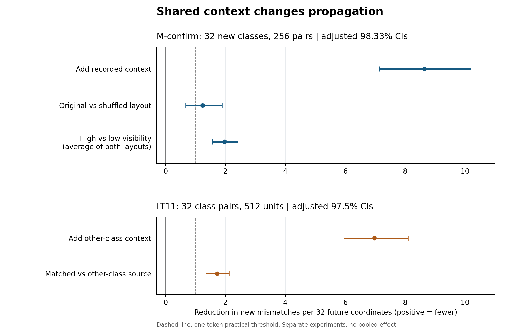
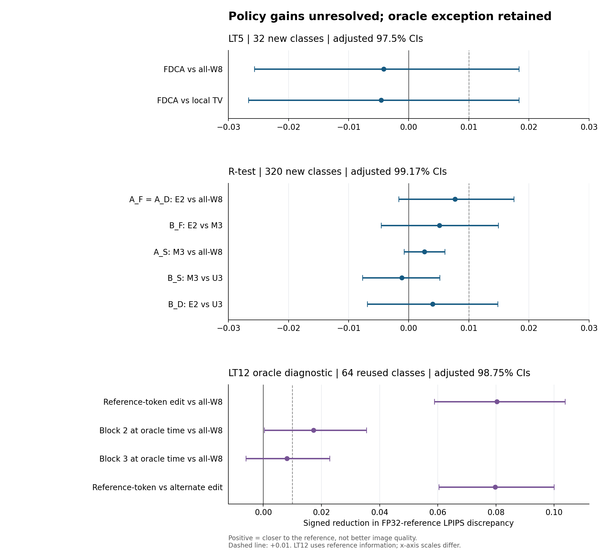
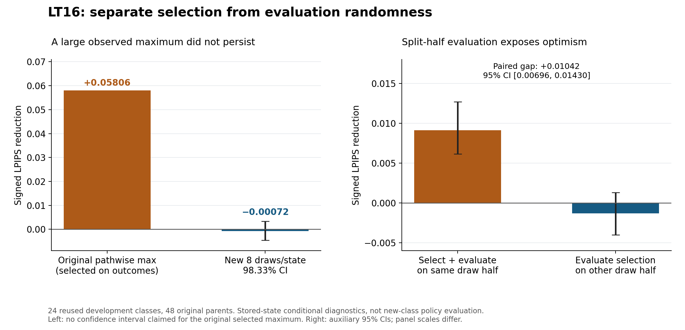

# From divergence measurement to an unsuccessful restoration policy

**FDCA follow-up research portfolio · Munsik Kim · 13 November 2026**

Retrospective synthesis of LT0–LT16 and the intervening paper-evidence experiments. This is a research record, not a peer-reviewed algorithm claim or a new preregistration.

**The useful result is a separation:** controlled experiments support context-dependent propagation of token differences, but the tested reference-free precision-restoration policies did not establish reliable gains over the specified baselines. A diagnostic that measures how much a perturbation matters is not automatically a controller that knows how to improve an output.

| What the project established | What it did not establish |
|---|---|
| A way to isolate a first divergence, control shared context, and track subsequent token differences | A universal causal effect of generation time |
| Context interventions replicated on new experimental classes | Better perceptual quality or generalization to another model family |
| A large oracle-token repair effect, and a positive block-2 restoration effect at an oracle-known time | A deployable way to recover those oracle benefits |
| Repeated-randomness evidence that a large observed maximum did not persist | An impossibility theorem for restoration |
| Model-free replay of key numerical conclusions and explicit stopping decisions | A new GPU reproduction of every archived experiment |

## Read the portfolio

- **[Detailed research report in Korean](REPORT_KO.md)** — objectives, full chronology, positive and negative findings, and their implications.
- **[Model, interventions and exact comparisons](METHODS_KO.md)** — what was quantized/restored, the two trajectories, shared tokens, coupling, estimands and inference.
- **[Failure analysis](FAILURE_ANALYSIS_KO.md)** — evidence for selection optimism, the gap between sensitivity and signed gain, competing explanations, and preserved exceptions.
- **[Next-research decision plan](NEXT_RESEARCH_KO.md)** — proposed controls, independent randomness, stop/go criteria and protected holdout handling. Not executed.
- **[Evidence and validation boundaries](EVIDENCE_AND_VALIDATION.md)** — original-source provenance, reuse, missing artifacts, and what the public replay actually checks.
- [Experiment ledger](data/experiment_ledger.csv) · [Source manifest](data/source_manifest.json) · [Original numerical tables](evidence/tables/) · [Historical completion summaries](evidence/summaries/).



M-confirm uses 32 new experimental classes and 98.33% intervals for three primary comparisons. LT11 uses 32 class pairs, comprising 64 new experimental classes, and 97.5% intervals for two primary comparisons. These are separate experiments, not a pooled estimate. “New” refers to this experimental history, not to the model's pretraining data.



Intervals and populations differ by panel. LT12 uses reference-derived timing or tokens and reuses R-test classes. Its positive results are diagnostic; they are not held-out performance of a reference-free policy.



LT14's observed pathwise maximum was +0.05806 LPIPS. At those selected stored states, LT16's fresh-randomness estimate was −0.00072, with an adjusted interval spanning zero. The split-half experiment independently exposes optimism from selecting and evaluating on the same random draws. Neither analysis evaluates new classes.

## Reproduce the published numerical evidence

From the repository root, with the model-free environment installed:

```bash
python -B research/followup_2026_11/scripts/replay_public_evidence.py \
  --output build/followup-replay
```

This verifies source SHA-256 bindings; reconstructs M-confirm's six contrasts; reconstructs R-test's six primary contrasts and LT10's 13 comparisons; and replays LT16's 16 tables, numerical JSON, bootstrap arrays and independently coded scalar audit. It requires NumPy and the Python standard library, not checkpoints, images or private disks. Outputs go under `build/`, outside the published evidence.

```bash
# Optional figure regeneration; matplotlib is an additional dependency.
python -B research/followup_2026_11/scripts/build_figures.py
make verify test reproduce
```

## Relationship to the original paper

The original `v1.0.0` paper, release and DOI remain historical artifacts. Scientific corrections are documented in [PR #2](https://github.com/Munsik-Kim/fdca-visual-token/pull/2), which was open and unmerged when this addendum was prepared. This addendum uses the corrected distinction between `mean(h*m)`, `mean(h)*mean(m)` and split-weighted consequences. It does not silently revise the archived paper or represent that PR as merged.

The portfolio records research design, controlled model interventions, statistical diagnostics, reproducibility engineering, and a decision to stop an unvalidated policy direction. The outcome is **a stronger account of propagation and a bounded negative algorithmic result**, not a claim to have improved image-generation quality.

Original code follows the repository's MIT license; reports, tables and figures follow its CC BY 4.0 scope. Model weights, datasets, full probability laws, private delivery links and reserved holdout identities are not redistributed.
