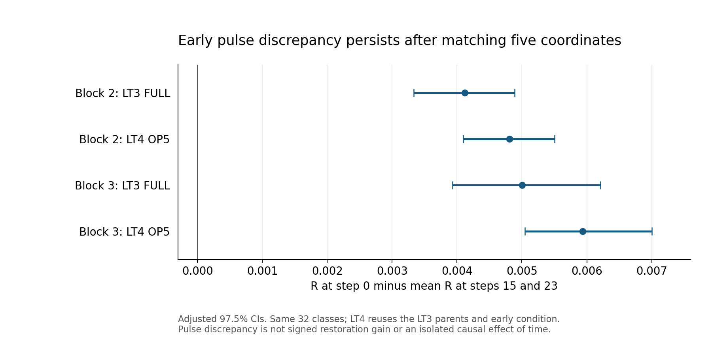

# FDCA 추가 연구 종합 보고서

**연구 목표, 전파 실험, 복원 정책의 실패와 다음 연구의 조건**

작성 기준: 2026-11-13 · 연구자: Munsik Kim · 상태: 사후 종합 연구 기록

[포트폴리오 첫 화면](README.md) · [모델과 비교군](METHODS_KO.md) · [실패 분석](FAILURE_ANALYSIS_KO.md) · [후속 연구 계획](NEXT_RESEARCH_KO.md) · [근거와 재현](EVIDENCE_AND_VALIDATION.md)

## 1. 이 연구가 달성하려던 것과 실제 도달한 곳

출발 질문은 “작은 가중치 근사가 시각 토큰 생성의 어느 지점에서 첫 선택을 바꾸며, 그 차이가 최종 출력까지 얼마나 전파되는가?”였다. 추가 연구는 여기서 한 걸음 더 나아가 “영향이 큰 block·시점을 알면, 제한된 FP32 복원을 그곳에 배치하여 참조 출력과의 차이를 줄일 수 있는가?”를 시험했다.

현재 자료는 두 질문에 서로 다른 답을 준다. **공통 문맥과 배치는 최초 불일치 이후의 전파를 바꾼다. 그러나 조사한 전파 점수·국소 특징을 이용한 복원 정책의 안정적인 추가 이득은 확인하지 못했다.** 초기 pulse의 영향이 크다는 결과와 초기 복원 정책이 유리하다는 주장은 동일하지 않다.

| 목표 | 성공 기준 | 현재 상태 |
|---|---|---|
| 측정과 분해 | 첫 차이의 발생과 이후 결과를 구분하고 재계산 가능 | 조건·결합·집계를 명시한 진단 체계 구축 |
| 전파 메커니즘 | 최초 차이를 맞춘 상태에서 문맥 개입 효과 확인 | 새 실험 클래스의 M-confirm과 LT11에서 지지 |
| 복원 정책 | 참조 없는 정책의 절대 G와 강한 동일 행동 대조 대비 추가 G | LT5/R-test 미확정, LT14 개발 gate 실패 |
| 선택 가능성 | 원 관측 최대값이 독립 난수에서 유지되는지 | LT16에서 유지되지 않음; 선택 낙관성 근거 |
| 일반적 알고리즘 | 새 클래스·다른 모델·비용·품질에서 검증 | 미달성; LT15 미실행 |

이 포트폴리오의 기여는 성공한 이미지 개선 알고리즘을 발표하는 데 있지 않다. 가설을 통제 실험으로 나누고, 긍정적 기전 결과와 부정적 정책 결과를 함께 보존하며, 다음 단계로 넘어가지 않을 근거를 만든 연구 과정에 있다.

## 2. 원 논문 정정에서 출발한 해석 원칙

원 공개판 `v1.0.0`은 보존했다. [v1.0.1 정정 PR #2](https://github.com/Munsik-Kim/fdca-visual-token/pull/2)는 이 보고서 작성 당시 OPEN이며 병합되지 않았다. 정정은 새 GPU 실험이 아니라 정의·계산·증명 가정·서술의 정확도를 다룬 작업이다.

핵심은 `R=mean(h*m)`이며 `mean(h)*mean(m)`과 일반적으로 같지 않다는 점이다. `M_equal`, split 확률로 가중한 `M_split`, covariance를 구분했다. attribution은 block별 대칭 분해 후 평균하도록 바로잡았다. single-shock/common-W8-suffix와 지속 양자화, 출력 discrepancy와 품질, 겹치는 subset과 독립 표본을 분리했다. 정리의 비용·결합·상태·global influence 가정을 명시하고, 원 계획과 실제 quantizer granularity의 차이를 deviation으로 남겼다.

당시 재계산에서 ρ=.5−.3의 R 차이는 Tiny +0.001714, Small +0.001966이었다. 이 수치는 원 논문의 panel과 사후 100,000/linear paired-block 분석에 속한다. 원 20,000/higher 구간과 함께 보존해야 하며, 11월 32단계 후속 실험의 효과로 합치면 안 된다. 정정 보고의 Tiny n=48, Small n=40 역시 후속 연구의 새 32클래스 또는 320클래스와 다른 단위다.

이후 연구는 정의를 엄격하게 유지하는 방향으로 진행했다. 특히 큰 discrepancy를 곧바로 큰 품질 손실 또는 큰 복원 이득으로 부르지 않는다.

## 3. 전체 실험 지도

날짜가 포함된 실험 ID는 동결·실행·전달 시점에 걸쳐 있을 수 있다. 아래는 논리적 진행 순서이며, 각 행의 표본 수를 더해 독립 표본 수를 만들면 안 된다. 정확한 원본 위치는 [실험 ledger](data/experiment_ledger.csv)와 [source manifest](data/source_manifest.json)를 따른다.

| 단계 | 목적과 개입 | 표본·재사용 | 결과와 다음 판단 |
|---|---|---|---|
| LT0/LT1 | 계약 고정, 지속 단일 block W8 민감도 | 16클래스, arm당 32경로, 8arms | block 2/3 관심; local TV 이상의 선택 가치는 미확인 |
| LT1-R | all-W8에서 block 하나를 전체 단계 FP32 복원 | 재사용 개발 8클래스, 96복원 경로 | 모든 절대 G 구간 0 포함; 세 점수가 같은 block 3 선택 |
| LT2 | FP32/W8 상태 배경, local law, 자연 pulse | 재사용 8클래스; 상태 진단 256, pulse 1,024쌍 | 국소 차이는 있으나 상태 효과·최종 pulse 차이 미확정 |
| LT2C | 실제 불일치 조건부 pulse와 h 가중 | 8클래스, 16부모, 총 832쌍 | 초기 pulse R이 큰 탐색 신호 |
| LT3 | 초기 대비를 새 클래스에서 확인 | 새 32클래스, 64부모, 1,792쌍 | block 2/3 초기 대비 모두 양수 |
| LT4/OP5 | shock 좌표 수를 5개로 맞춤 | LT3 클래스·부모 재사용; 새 1,024쌍, 초기 512재사용 | 기회 수를 맞춘 후에도 초기 대비 유지 |
| LT5 | 8 block-step 예산 정책 | 새 32클래스, 64단위, 후보 320경로 | FDCA 절대·local TV 대비 추가 G 미확정 |
| LT6 | 동일 첫 차이와 후속 32좌표, 공통 문맥 추가 | LT3 32클래스 재사용, 512쌍 | 평균 후속 불일치 약 8.25개 감소 |
| LT7/M-dev | 배치·가시 범위 대조 보완과 개발 | 기존 개발 자료 재사용 | 누락된 이전 완료본 대신 새 실행 ID 동결 |
| M-confirm (LT8) | 문맥·배치·가시 범위 확인 | 새 32클래스, 256짝 | 세 방향 확인; 문맥·가시 범위는 한 토큰 하한 초과 |
| R0/R-cal | 복원 기간 진단 및 정책 동결 | 기존 자료·개발 클래스 | 지속 시간 우열 미확정; 정책 alias 명시 |
| R-test (LT9) | 동결 정책과 8개 복원 행동 평가 | 새 320클래스, 640단위 | 여섯 주 구간 0 포함 |
| R-alt | 결합을 바꾼 민감도 | R-test 내 32클래스 | 정책 우위 확인 못함; 결합 불변성도 미입증 |
| LT10 | 8개 행동의 13개 사후 비교 | 같은 R-test 320클래스 | 보정 구간 모두 0 포함 |
| LT11 | 다른 클래스 문맥과 자기 문맥 교환 | 새 64클래스=32쌍, 512단위 | 공유 자체 효과와 출처 일치의 추가 효과 지지 |
| LT12 | 최초 불일치 토큰 편집, oracle 시점 복원 | R-test의 64클래스 재사용, 128단위 | 참조 토큰 편집 큰 이득; block 2 복원 양의 방향 |
| LT13 | 자기 최초 차이 시점과 교환 시점 | 원 32클래스 쌍; redraw 8쌍 | 원 난수 우위, 새 난수 방향 미확정 |
| LT14 | 현재 W8 특징으로 시점 선택 | 개발 24클래스, 48경로, 32시점 후보 | ENTROPY 대비 +0.000618로 +0.005 gate 실패 |
| LT15 | 미노출 클래스 확인 | 예약 265클래스, 접근·실행 0 | `NOT_STARTED_DEV_CRITERIA` |
| LT16 | 선택 시점의 새 난수 평균과 선택 낙관성 | LT14 재사용, 158상태×8=1,264실험 | 원 최대 유지 안 됨; 세 주 대비 미확정 |

## 4. LT1/LT1-R: 어느 층을 바꾸느냐가 중요한가

LT1의 all-W8 참조 거리 평균은 0.153190, 탐색적 95% CI [0.111082, 0.201793]이었다. 32경로 모두에서 분기가 있었고 최종 토큰 Hamming 비율은 약 0.237671이었다. 단일 block W8의 출력 discrepancy 점추정 순위는 2, 3, 1, 0, 5, 4였다. 여섯 점에 대한 local TV와 discrepancy의 Spearman 0.942857은 기술적 순위 일치이며 통계적 독립 확인이나 FDCA 우월성이 아니다.

LT1-R은 질문을 뒤집어 all-W8에서 한 block을 지속 FP32로 복원했다. 8개 재사용 개발 클래스의 baseline은 0.137451로 LT1 전체 panel의 baseline과 다르다.

| 복원 block | 참조와의 LPIPS | G | 탐색적 95% CI |
|---|---:|---:|---|
| 0 | 0.097892 | +0.039559 | [−0.021962, +0.110878] |
| 1 | 0.128885 | +0.008567 | [−0.025743, +0.048331] |
| 2 | 0.173604 | −0.036153 | [−0.108385, +0.062926] |
| 3 | 0.086244 | +0.051207 | [−0.026468, +0.159815] |
| 4 | 0.134484 | +0.002967 | [−0.105070, +0.128256] |
| 5 | 0.178982 | −0.041531 | [−0.100375, +0.038140] |

block 3은 uniform 평균보다 +0.047105 [0.014383, 0.080723] 유리했지만, local TV·단일층 민감도·FDCA delta-TV가 모두 같은 block을 골랐다. 따라서 “FDCA를 써야 얻는 이득”은 분리되지 않았다. block 3의 클래스별 양의 G도 4/8이었다. 음의 점추정을 삭제하지 않았고 악화 확정으로도 부르지 않았다.

출처: [LT1 arm 표](evidence/tables/lt1_arms.csv), [LT1-R 복원](evidence/tables/lt1r_restoration.csv), [정책 비교](evidence/tables/lt1r_policies.csv).

## 5. LT2/LT2C: 국소 차이와 최종 전파를 분리

LT2는 FP32 상태 X와 W8 상태 Y를 분리하여 block 2/3의 local 복원 효과와 single pulse를 비교했다. 주 시점은 0, 15, 23이며 31은 suffix가 없는 말단 대조로 별도 취급했다.

| 대비 | 추정치 | 탐색적 95% CI |
|---|---:|---|
| Y에서 block 3−2의 국소 복원 이득 | +0.0005882 | [+0.0000768, +0.0010862] |
| 위 차이의 Y−X 변화 | +0.0001101 | [−0.0001800, +0.0004344] |
| 자연 pulse 출력 LPIPS의 block 3−2 | +0.0001978 | [−0.0044158, +0.0048685] |

1,024쌍 중 실제 분기는 88건이었다. LT2C는 드문 분기 사건을 조건부로 추출하고 원 발생 확률 h를 곱해 추정했다. 총 832쌍은 주 시점 768쌍과 말단 64쌍의 합이다. 모든 조건부 경로에서 불일치가 발생했다고 자연 H를 1로 놓지 않았다.

LT2C에서 block 3−2의 평균 pulse R 차이는 −0.0001748 [−0.0010768, +0.0004174]로 미확정이었다. 반면 초기 0단계와 뒤 15·23단계 평균의 차이는 block 2 +0.0063778, block 3 +0.0060950으로 양수였다. 이것이 새 클래스의 초기 대비 확인으로 이어졌다.

같은 자료에서 block 2의 R은 0.0046860, H×M_equal은 0.0075290, covariance는 −0.0028430이었다. 평균 곱이 실제 R을 상당히 과대평가하므로 집계 정의가 실험 결론에 실질적으로 중요했다.

출처: [LT2](evidence/tables/lt2_contrasts.csv), [LT2C 대비](evidence/tables/lt2c_contrasts.csv), [h·m 분해](evidence/tables/lt2c_pulse.csv).

## 6. LT3/LT4: 초기 pulse의 영향은 재현되었나

LT3의 새 32클래스에서 사전 고정한 두 초기 대비는 모두 양수였다. LT4는 같은 클래스와 부모에서 shock 좌표를 5개로 맞춰 “초기와 후기의 개입 기회 수가 달라서 생긴 결과인가?”를 점검했다.

| 조건 | block | 초기 R−뒤 두 시점 평균 | 보정 97.5% CI |
|---|---:|---:|---|
| LT3 FULL | 2 | +0.0041214 | [+0.0033338, +0.0048886] |
| LT3 FULL | 3 | +0.0050004 | [+0.0039328, +0.0062097] |
| LT4 OP5 | 2 | +0.0048058 | [+0.0040980, +0.0055033] |
| LT4 OP5 | 3 | +0.0059366 | [+0.0050483, +0.0070010] |

LT3では 클래스별 초기 대비가 block 2에서 31/32, block 3에서 32/32 양수였다. OP5−FULL의 초기 대비 변화도 block 2 +0.0006844, block 3 +0.0009361의 보조 95% 구간이 양수였다.

이는 지정한 상태·스케줄·결합에서 초기 pulse 기대 discrepancy가 크다는 근거다. OP5는 좌표 수를 맞추지만 남은 horizon, 이미 채워진 상태, 좌표 내용까지 모두 고정하지 않는다. 시간 그 자체의 보편적 인과효과, 다른 모델의 특성, 이미지 품질을 결론으로 삼지 않았다. LT4는 LT3를 재사용했으므로 새 독립 확인으로 세지 않는다.

출처: [LT3](evidence/tables/lt3_contrasts.csv), [LT4](evidence/tables/lt4_contrasts.csv).

## 7. LT5: 전파 점수를 복원 정책으로 바꾼 첫 독립 평가

새 32클래스·64단위에서 8 block-step 예산을 썼다. FDCA는 E2(block 2, 0–7단계), local TV는 M3(block 3, 12–19단계)를 골랐다. EARLY는 E3, UNIFORM은 U3였다. 평가값은 pulse discrepancy가 아니라 FP32 참조와의 거리 감소 G다.

| 대비 | 추정치 | 구간 |
|---|---:|---|
| A: FDCA−all-W8 | −0.0041609 | 주 97.5% [−0.0256513, +0.0183380] |
| B: FDCA−local TV | −0.0045728 | 주 97.5% [−0.0266419, +0.0183619] |
| T: EARLY−UNIFORM | +0.0044175 | 보조 95% [−0.0085965, +0.0177429] |

두 주 결과는 미확정이다. 초기 pulse 결과를 그대로 “초기 복원이 좋아야 한다”로 옮기는 주장을 지지하지 않았다. 음의 점추정으로 악화를 확정한 것도 아니다. 구현·저장 law 검산은 통과했지만 중단 과정에서 잃은 세부 비용 카운터는 한계로 기록했다.

출처: [주 결과](evidence/tables/lt5_primary.csv), [보조 대비](evidence/tables/lt5_auxiliary.csv), [정책](evidence/tables/lt5_policies.csv).

## 8. LT6–M-confirm: 무엇이 전파를 억제하는가

LT6는 같은 최초 불일치와 같은 후속 32좌표를 두고 공통 문맥을 채웠다. 재사용한 32클래스의 512짝에서 평균 새 불일치는 11.693개에서 3.441개로 줄었고 차이는 8.252개였다. 원 완료 보고의 95% CI는 약 [7.262, 9.223]개였다.

**출처 한계:** 이번 공개 준비에서 LT6 단독 compact와 원 95% bootstrap 자료를 확보하지 못했다. 후속 M-dev 원표에 같은 점추정이 포함되어 이를 대조했지만, M-dev의 98.3333% 구간을 LT6 원 95% 구간처럼 제시하지 않는다. LT6의 원 실행·원 구간은 연구자 완료 기록 수준이고, M-confirm은 공개 단위 데이터에서 별도로 수치 재생했다.

LT7 보완과 M-dev를 거쳐 M-confirm은 새 32클래스의 256짝으로 넘어갔다. 같은 문맥 값의 순열과 낮은 가시 범위를 대조에 넣어 단순 “문맥 있음/없음” 설명을 보강했다.

| 주 대비 | 감소량, 개/32좌표 | 보정 98.3333% CI | 실용 기준 |
|---|---:|---|---|
| SPARSE→REAL_H | +8.6445 | [+7.1367, +10.1992] | 하한 >1개 |
| SHUF_H→REAL_H | +1.2383 | [+0.6719, +1.8906] | 방향 확인, 하한 >1개 미확정 |
| 낮음→높음, 두 배치 평균 | +1.9766 | [+1.5703, +2.4180] | 하한 >1개 |

문맥의 **가시성과 값이 함께 추가되는 개입**이 후속 차이를 줄였다. 같은 값의 집합에서도 원래 위치 배치가 더 유리했다. 가시 범위 효과는 두 배치 조건의 평균이다. 원래 배치만의 차이는 1.9023개다. 조건별 평균은 SPARSE 11.8789, REAL_H 3.2344, SHUF_H 4.4727, REAL_L 5.1367, SHUF_L 6.5234개였다.

이 결과로 “문맥이 더 많으면 이미지 품질이 좋아진다”거나 “이미 생긴 모든 차이를 복구한다”고 말할 수 없다. 결과 변수는 지정한 두 상태의 후속 토큰 불일치다. 실제 정책이 좋은 문맥을 어떻게 얻고 비용을 지불할지도 별도 문제다.

출처: [M-dev](evidence/tables/m_dev_contrasts.csv), [M-confirm 대비](evidence/tables/m_confirm_contrasts.csv), [256짝의 원 집계](evidence/tables/m_confirm_units.csv).

## 9. R0/R-cal/R-test/R-alt와 LT10: 복원을 더 촘촘하게 비교

R0은 기존 32클래스에서 8단계−1단계 복원을 비교했다. block 2 +0.001989, block 3 +0.003518의 95% 구간 모두 0을 포함했다. 한 번의 복원이 약해서 실패한 것이라는 설명을 확정하지 못했다.

R-cal은 개발 자료에서 F(pulse 기반), L(local TV), S(signed pulse), D(개발 복원 G)와 강한 비교군 Bstar를 동결했다. F=D=E2, L=S=M3, Bstar=U3였다. 같은 행동을 고른 두 이름을 서로 다른 알고리즘 성공으로 세면 안 된다. 8개 실제 행동은 E/M/L/U 시점 배치×block 2/3이다.

새 320클래스·640단위의 R-test는 Q와 8개 행동의 5,760개 endpoint를 제공했다. 정책은 시험 표본 결과를 보기 전에 정한 매핑을 사용했다.

| 주 대비 | 추정치 | 보정 99.1667% CI |
|---|---:|---|
| A_F: E2−Q의 이득 | +0.0077134 | [−0.0016589, +0.0174880] |
| B_F: E2−M3의 추가 이득 | +0.0051027 | [−0.0045619, +0.0149288] |
| A_S: M3−Q의 이득 | +0.0026107 | [−0.0007884, +0.0059923] |
| B_S: M3−U3의 추가 이득 | −0.0011354 | [−0.0076962, +0.0051490] |
| A_D: E2−Q의 이득 | +0.0077134 | [−0.0016589, +0.0174880] |
| B_D: E2−U3의 추가 이득 | +0.0039673 | [−0.0068709, +0.0148276] |

여섯 구간 모두 0을 포함한다. A_S/B_S는 전체 구간이 사전 실용 범위 ±0.01 내부다. F의 구간은 +0.01 이상의 이득도 허용하므로 “효과 없음 확정”이라고 부르지 않는다. 동일 경로와 다른 비교군 때문에 F와 D의 절대 효과는 같고 추가 이득은 다르다.

R-alt는 같은 32클래스 부분집합에서 결합을 바꾸었다. 원·대체 결합에서 정책 우위를 일관되게 확인하지 못했다. LT10의 사후 paired 결합 차이 중 B_S에는 양의 보조 95% 신호가 있었으므로 “결합은 상관없다”고도 말할 수 없다.

LT10은 기존 8개 행동에서 block·시점의 13개 대비를 구성했다. 13개 보정 구간 모두 0을 포함했다. E2−L2와 M2−L2의 미보정 95% 구간이 양수라는 사실은 보조 결과로 보존하며, 보정 결과를 대체하지 않는다. 새로운 GPU 실험이나 새 320클래스 확인이 아니다.

출처: [R0](evidence/tables/r0_contrasts.csv), [정책 동결](evidence/tables/r_test_policy.json), [R-test](evidence/tables/r_test_primary.csv), [5,760 endpoints](evidence/tables/r_test_endpoints.csv), [R-alt](evidence/tables/r_alt_contrasts.csv), [LT10 13대비](evidence/tables/lt10_13_contrasts.csv), [결합 차이](evidence/tables/lt10_coupling_difference.csv).

## 10. LT11/LT12: 문맥 출처와 수정 방향

LT11은 새 64클래스를 32쌍으로 묶어 문맥 출처를 교환했다. 다른 클래스에서 온 값도 두 경로가 공통으로 받으면 후속 32좌표 불일치를 평균 6.9727개 줄였다. 자기 출처 문맥은 여기에 1.7207개를 더 줄였다. 두 주 97.5% 구간 [5.9570, 8.1016], [1.3496, 2.1211]의 하한은 모두 한 토큰을 넘었다.

이로써 “오직 자기 클래스의 내용이어서만 전파가 줄었다”는 설명은 약해진다. 그러나 출처 일치에는 값·배치·상태 적합성이 함께 들어가므로 순수 의미 효과라고 단정하지 않는다. W64 등 보조 horizon도 원표에 보존했다.

LT12는 R-test 중 64클래스·128단위를 재사용하여 최초 불일치를 참조 토큰으로 맞췄다. 발생한 127 trigger와 미발생 1단위의 포함 규칙을 구분했다. B_dir는 대체 편집이 가능한 127단위를 클래스 동일 가중으로 분석한다.

| 개입/대비 | G 또는 추가 G | 보정 98.75% CI |
|---|---:|---|
| 참조 토큰 편집−Q | +0.0802895 | [+0.0587964, +0.1038019] |
| oracle 시점 block 2 복원−Q | +0.0173106 | [+0.0003611, +0.0354294] |
| oracle 시점 block 3 복원−Q | +0.0081557 | [−0.0059764, +0.0228149] |
| 참조 토큰 편집−대체 토큰 편집 | +0.0797281 | [+0.0603381, +0.0999471] |

큰 효과는 “어디를 어떤 값으로 바꾸는가”의 중요성을 보여준다. 특히 block 2 복원의 양의 방향은 복원 전체를 무효로 단정할 수 없는 근거다. 다만 trigger 위치와 참조 토큰은 FP32 경로에서 얻었다. 이 결과는 참조 없이 배포할 수 있는 정책의 성능이 아니다.

출처: [LT11](evidence/tables/lt11_contrasts.csv), [LT12](evidence/tables/lt12_primary.csv).

## 11. LT13/LT14/LT15: 참조 없이 시점을 고를 수 있는가

LT13은 자기 최초 불일치 시점과 다른 클래스에서 교환한 시점을 비교했다. 원 난수 32클래스 쌍, 126경로에서 차이는 +0.0148582, 탐색적 95% [0.0032243, 0.0271863]이었다. 저장 상태에서 새 suffix 난수로 전개한 8쌍에서는 −0.0126025 [−0.0387787, +0.0080830]로 방향 미확정이었다. redraw도 원 경로에서 선택된 시점과 상태를 사용하므로 완전히 새 실험 분포가 아니다.

LT14는 개발 24클래스·48경로에서 block 2의 일회 복원 시점 32개를 평가하고, 현재 W8 상태의 특징으로 선택기를 만들었다. 클래스 단위 네 outer fold를 사용해 제안과 entropy·margin·histogram·drift·고정 시점·uniform 등의 동일 행동 대조를 비교했다. 기준 정책들은 해당 특징을 사용하는 비교 구현이며 다른 논문의 전체 알고리즘 재현이라고 주장하지 않는다.

제안 OOF G는 +0.0058843, 가장 강한 대조 ENTROPY는 +0.0052659였다. paired 차이는 +0.0006184이며 4fold 중 3개에서 양수였지만, 사전 진행 기준 +0.005에 못 미쳤다. 이에 따라 **LT15는 시작하지 않았다.** 예약된 미노출 265클래스의 모델 호출과 확인 표본 접근은 0으로 기록됐다.

원 32시점 결과를 모두 본 뒤 각 경로의 최대값을 택하면 +0.0580628이었다. 이것이 개발 가능성의 단서인지 단일 난수 선택의 과대평가인지 구분하기 위해 LT16으로 이어졌다. 이 최대를 알고리즘 성능으로 제시하지 않았다.

출처: [LT13](evidence/tables/lt13_contrasts.csv), [LT14 전체 정책](evidence/tables/lt14_policy_summary.csv), [개발 gate](evidence/tables/lt14_dev_gate.json), [사후 최대](evidence/tables/lt14_observed_maximum.json).

## 12. LT16: 기대 이득을 다시 물었을 때

LT16은 같은 LT14 개발 클래스와 저장 상태를 사용했다. 다섯 고정 선택 규칙의 240참조를 158고유 상태로 합치고, 상태마다 새 난수 8회를 실행했다. 참조 P와 Q/복원은 각자의 저장 pre-state에서 출발하며 개입 단계도 새 난수로 뽑는다. 원 baseline LPIPS를 새 복원 경로에서 빼는 방식이 아니다.

| 주 대비 | 추정치 | 보정 98.3333% CI | 고정 부모 MCSE |
|---|---:|---|---:|
| A: OLD_MAX G | −0.0007234 | [−0.0046438, +0.0033003] | 0.0015043 |
| B: OLD_MAX−ENTROPY | +0.0005042 | [−0.0043312, +0.0055059] | 0.0021539 |
| C: 제안−시간만 사용 | +0.0001618 | [−0.0002543, +0.0010123] | 0.0002826 |

세 대비 모두 방향 미확정이다. A의 구간 상한은 +0.01보다 작고, C는 전체가 ±0.005 내부다. B는 상한이 +0.005를 조금 넘으므로 같은 방식으로 실용 범위 안이라고 하면 안 된다.

다섯 새 평균 G는 OLD_MAX −0.0007234, 제안 +0.0009533, ENTROPY −0.0012275, 시간만 +0.0007915, 고정 −0.0004339였다. 원 최대 +0.05806이 새 난수 평균으로 유지되지 않았다. 난수 절반에서 선택·평가하면 +0.0091272, 다른 절반에서 평가하면 −0.0012947이었다. 이 분리 결과는 단일 난수 최대값을 학습 대상으로 삼기 전에 반복 평균과 독립 평가가 필요함을 보여준다.

이 실험은 저장 상태의 조건부 재평가다. 새 클래스 성능이나 처음부터 도는 온라인 정책을 평가하지 않았다. 반복 K=8의 MCSE도 남아 있다. 따라서 학습 가능한 기대 이득이 전혀 없다는 결론은 과도하지만, 기존의 큰 관측 최대에 근거해 LT15를 열 이유도 확보되지 않았다.

출처: [LT16 주 대비](evidence/lt16/expected/primary_contrasts.csv), [선택 규칙](evidence/lt16/expected/selector_summary.csv), [보조 대비](evidence/lt16/expected/auxiliary_contrasts.csv), [1,264개 수치 입력](evidence/lt16/numeric/STATE_DRAWS.csv), [동결 분석 계약](evidence/lt16/ANALYSIS_CONTRACT.json).

## 13. 실패와 기술 검증을 함께 남기는 이유

여러 단계가 CPU law 감사, paired 집계 재생, D 보존본 해시 검사와 compact 추출 재생을 수행했다. 이는 오류 가능성을 줄이는 작업이지만 과학적 효과의 성공 판정과 별개다. 구현이 검산되어도 가설은 실패할 수 있고, 양의 효과가 있어도 검증 범위는 제한될 수 있다.

숨기지 않은 이력에는 LT2 preflight 실패, LT5 중단과 세부 counter 손실, LT6 감사기의 누적 batch 해석 수정, LT7 이전 완료본 미발견과 새 run ID, M-confirm forward counter 수정, LT13 중복 D 전체 law 재생 일부 종료, LT14 D 재생 CSV 열 순서 수정 등이 있다. LT13의 부분 재생과 완료된 다른 감사는 서로 다른 작업이며 하나의 전면 PASS로 합치지 않는다. 일부 중간 문서에는 완료 전 상태가 남아 있으므로 최종 상태와 작성 시점을 구분한다.

이번 공개 준비에서는 모델이나 raw categorical law를 새로 실행하지 않았다. 확보한 수치 자료를 바탕으로 M-confirm, R-test/LT10, LT16을 모델 없이 재생하고 원표와 대조했다. 원 GPU·전체 raw 감사의 완료 사실은 역사적 실행 기록이며 이번 검산의 성과로 중복 계산하지 않는다.

## 14. 연구 의의와 현재의 주장 범위

이 연구는 작은 근사와 최종 출력의 관계를 하나의 평균 오차로만 다루지 않고, **발생 사건·상태·공통 문맥·후속 전개·수정 방향**으로 나누었다. 같은 최초 차이를 두고 문맥의 양·배치·출처를 바꾼 대조는 전파 현상을 더 구체적으로 설명한다. 또한 oracle 진단, 현실적인 정책, 선택된 최대값, 독립 난수 평균 사이의 간격을 드러냈다.

포트폴리오에서 제시할 수 있는 작업은 통제 실험 설계, 모델 내부 가중치 개입, 결합과 사건별 RNG 관리, 클래스 단위 통계, 다중 비교와 covariance 처리, 검산 가능한 수치 패키지, 실패한 gate에 따른 실행 중단이다. 논문의 novelty 우선권이나 타 연구 대비 최초라는 주장은 이 보고서가 새로 조사·확정한 범위가 아니다.

현재 논문에 적합한 중심 문장은 다음과 같다.

> 지정한 H-MaskGIT-T 설정에서 최초 토큰 불일치의 후속 전파는 공통 문맥의 가시 범위·배치·출처에 따라 달라졌다. 그러나 이 진단량을 제한된 정밀도 복원 정책으로 전환했을 때 사전 지정한 참조 거리 이득과 강한 기준 정책 대비 추가 이득을 일관되게 확인하지 못했다. 저장 상태의 반복 난수 실험은 단일 경로에서 고른 최대 이득에 선택 낙관성이 있음을 보여주었다.

## 15. 다음 연구로 넘기는 결정

현 one-block precision-restoration 선택기를 같은 형태로 확장하는 작업은 우선 중단하는 것이 타당하다. 미노출 표본을 더 열거나 여러 모델에 곧바로 복제하기 전에, 새 행동이 왜 signed 이득을 낼지와 이를 참조 없이 어떻게 식별할지를 다시 제시해야 한다.

우선순위가 높은 방향은 전파·문맥 메커니즘의 제한된 독립 확인과, 실제로 얻을 수 있는 문맥을 사용하는 개입의 효용·비용 평가다. 복원을 다시 시도한다면 독립 난수 평균 label, 선택/평가 분리, 무개입·시간만·entropy·동일 비용 대조를 갖추고 개발 기준을 먼저 통과해야 한다. 구체적인 제안과 중단 기준은 [다음 연구 계획](NEXT_RESEARCH_KO.md)에 정리했다. 이 계획은 아직 실행하거나 사전 등록한 것이 아니다.
